<p align="center">
  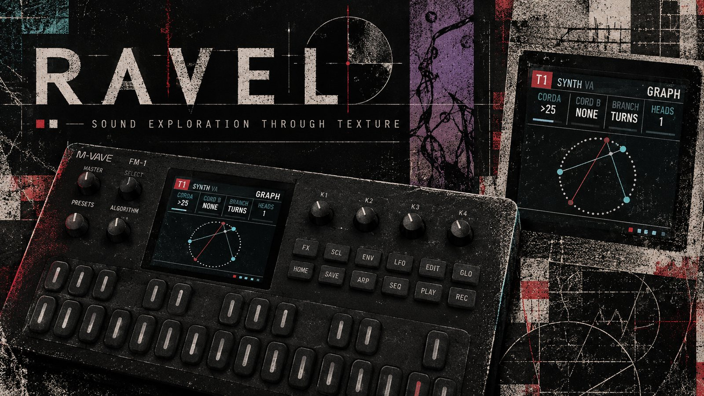
</p>

<h3 align="center">▶&nbsp; <a href="https://de-pattern.github.io/Ravel_FM1/">Open the emulator</a> &nbsp;·&nbsp; play Ravel in your browser</h3>
<h3 align="center">📖&nbsp; <a href="https://de-pattern.github.io/Ravel_FM1/manual.html">Read the manual</a> &nbsp;·&nbsp; <a href="https://de-pattern.github.io/Ravel_FM1/manual.pdf">PDF</a></h3>
<h3 align="center">⬇&nbsp; <a href="https://de-pattern.github.io/Ravel_FM1/install/">Install the firmware on an FM-1</a> &nbsp;·&nbsp; <a href="https://github.com/De-Pattern/Ravel_FM1/releases/latest">download the .fwsc</a></h3>

# Ravel

Ravel is a custom firmware for the M-VAVE FM-1 that turns the FM-1 into a pocket groovebox for sound design. It has 8 tracks that synthesize, strike and drum, and that play, excite, and reshape one another

<p align="center">
  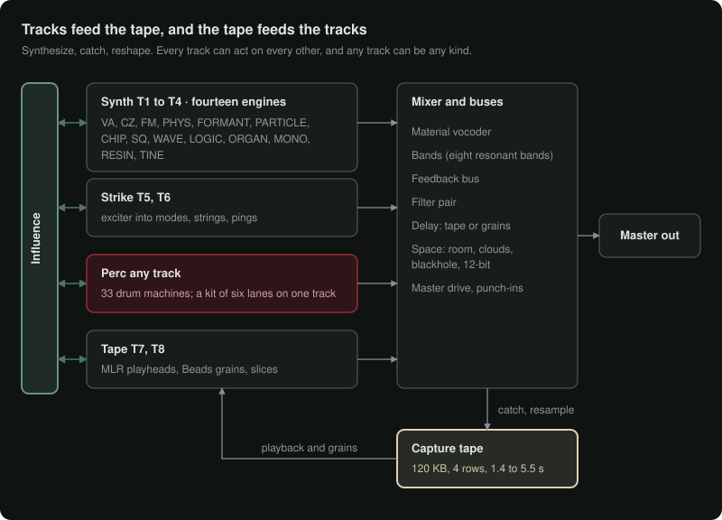
</p>

**Status: runs on the FM-1 and in the browser emulator.** The whole instrument runs in the browser emulator and the desktop simulator, from the same C sources the firmware is built from. The FM-1 firmware is bare metal (no vendor SDK) on the open hardware layer of the Felucca family of community firmwares, and installs from a web installer over USB. It is young: copy your projects to a computer now and then (the emulator's **Get from FM-1**), and report anything odd on the repository's issues.

<p align="center">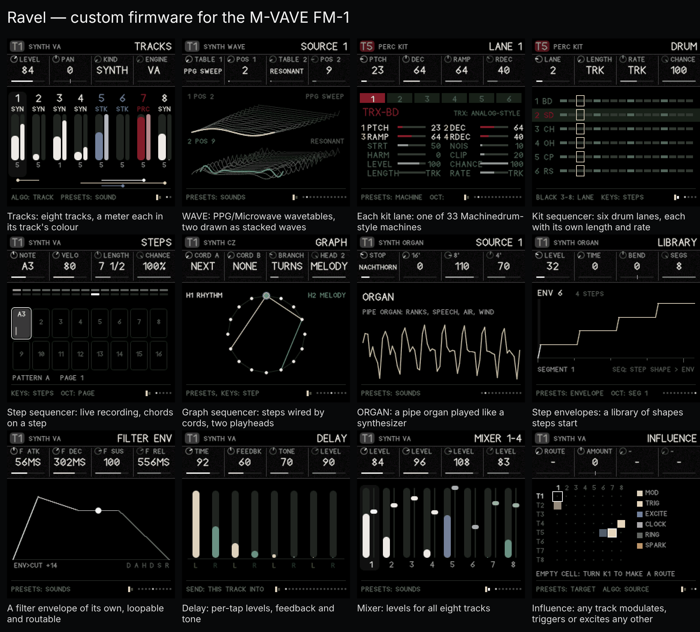</p>
<p align="center"><sub>More screens in <a href="docs/showcase/">docs/showcase</a>.</sub></p>

## What it is

- **Synth tracks** (T1 to T4), thirteen engines: **VA** (saw to pulse, supersaw, sync, sub, noise, through-zero FM), **CZ** (a full Casio CZ: two lines, the eight CZ waves, 8-step DCO, DCW and DCA envelopes, ring and noise modulation, vibrato and a Juno-60 style chorus), **FM** (4 operators, 12 algorithms, a wave per operator), **PHYS** (string, bowed, blown, membrane), **FORMANT** (vowel filter bank or FOF grains), **PARTICLE** (pulsar emitters that pull into sync), **CHIP** (SID-style waves arpeggiating through offsets, then a decompose stage that crushes and breaks the sound apart), **WAVE** (after the PPG Wave and Waldorf Microwave: two wavetable oscillators, sync, ring and FM, phase warps, a looping wave envelope), **LOGIC** (oscillators built from function blocks: arithmetic, bit logic and comparators between three sources, then pitch-synchronous grains), **ORGAN** (a pipe organ played like a synthesizer: ranks by footage, pipes that speak in their own time, chiff, air and wind), **MONO** (an SH-101-style voice played like a horn: legato, scoops, delayed vibrato), **RESIN** (a bowed string or a reed, pushed toward breaking down: scrape, flageolet, growl, multiphonics and a QUAKE knob that makes the player's hand shake), **TINE** (struck and plucked bars and tines: a rusty kalimba with buzzing rings, a marimba or balafon, and an electric piano after the Rhodes).
- **Strike tracks** (T5, T6), with GRAIN, a small difference in every hit (as on perc tracks): an exciter (click, noise, metal, FM burst, dust, rain, bow, breath, or EXT: another track's sound) strikes a body (ping filters, modal bars, a struck disc or coupled strings), with a transient layer, ring mod and a pitch drop.
- **Perc tracks** (any track, KIND PERC): 33 drum machines after the Elektron Machinedrum's synthesis families: TRX (analog-style), EFM (FM), P-I (physical models) and GND, each with the Machinedrum's track effects.
- **Arpeggiator** on any note track (ARP): up, down, up-down, down-up, as played or random, 1/4 to 1/32 of the clock, over up to four octaves, with gate, hold, repeats and chance; it plays held keys, the track's own steps and influence triggers alike.
- **COMP** (T8, off until you choose it): a glue compressor on the main mix after the SSL G-series bus compressor, with its stepped ratios, attacks and releases (and AUTO), threshold, makeup and a dry mix.
- **Influence:** an 8 × 8 grid where any track can modulate, trigger, excite, ring, clock, or spark (tap the body of) any other.
- **Articulation:** onset, continuant and termination stages with curve, overshoot, a loop, a tail and **Give** (a spring that lets the level lag and bounce), two destinations, its own FILTER ENV, and a library of 32 chainable step envelopes that steps start to move any parameter across the steps.
- **Sequencer:** each track runs in **STEPS** or **GRAPH** mode. Steps: length, rate and direction, parameter locks, microtiming, ratchets that bounce, climb, fall or darken as they roll, conditions, chance, microcuts of the mix with their own shape and size, and a EUCLID page that writes evenly spread hits into the steps. Graph (from Silt): cords set where a playhead goes next, two playheads walk the same graph, each playing notes, only the gate, or only the pitch (so rhythm and melody can take different paths), head 2 can play another track, and each head has a function generator (rise, fall, arch, decay, swell, or an LFO or dust) that moves its speed, times or plus the clock. Plus density arcs, a per-track note interval, scale quantizing, René-style clocking from LFOs or dust, and a two-oscillator master clock. Recording keeps what you play live, chords included (up to four notes on a step), or step by step while stopped (a note or chord a step, rests and back), and each kit lane can run at its own rate.
- **Modulation:** two LFOs, dust, an 8-slot matrix and 4 macros with 8 destinations each (curves and windows).
- **MIDI in** over USB and the TRS jack: notes on one channel, any, or channels 1–8 on tracks 1–8; velocity, mod wheel, aftertouch and pitch bend as matrix sources; clock (counted pulse by pulse, so it never drifts), start and stop.
- **Buses:** a granular tape delay (echoes and a grain cloud from one half-rate tape; wow, flutter, saturation, age, double tracking, freeze), a 12-BIT space (a gritty late-80s rack plate: decay, damp, motion, crunch, low cut), a feedback bus (filter, comb, smear, shift, fold or crush, a band filter in the loop, returning to the master or into a track), a BED of dust on a tuned wood-to-metal body that sinks under busy tracks and rises in the gaps, and master drive with microcuts (even, bouncing or dragging) and punch-in effects on the keys. Each bus page shows the current track's send into it. Every effect starts off: a new project sends nothing into any bus, and a bus with nothing coming in does not run at all.
- **Song:** patterns A and B per track, 16 scenes that switch or glide over 1–8 bars, a 32-row arrangement, mute and solo, tap tempo, 32 named project slots (compressed on the FM-1), and four banks of your own sounds that PRESETS reaches from any track; projects and sounds move between the emulator and an FM-1 as a .ravel file.

**New here?** Open the emulator ([Opening it](#1-opening-it)), load a demo, press Play, then read [The five moves](#3-the-five-moves-how-every-page-works). Everything else is reference.

## Contents

**The manual**

1. [Opening it](#1-opening-it)
2. [The panel](#2-the-panel)
3. [The five moves](#3-the-five-moves-how-every-page-works)
4. [How the parts connect](#4-how-the-parts-connect)
5. [HOME: tracks and influence](#5-home-tracks-and-influence)
6. [EDIT: the voice](#6-edit-the-voice)
7. [ENV: articulation](#7-env-articulation)
8. [LFO: modulation and macros](#8-lfo-modulation-and-macros)
9. [FX: the buses](#9-fx-the-buses)
10. [SCL: scale](#10-scl-scale)
11. [ARP: the arpeggiator](#11-arp-the-arpeggiator)
12. [SEQ: steps and the graph](#12-seq-steps-and-the-graph)
13. [GLO: song, scenes and clock](#13-glo-song-scenes-and-clock)
14. [SAVE: projects and sounds](#14-save-projects-and-sounds)
15. [Hold layers (every button held)](#15-hold-layers)
16. [Recording](#16-recording)
17. [Recipes, step by step](#17-recipes-step-by-step)
18. [Quick reference](#18-quick-reference)
19. [Questions people ask](#19-questions-people-ask)

**On the FM-1:** [Installing](#installing-on-the-fm-1) · [If the FM-1 will not start](#if-the-fm-1-will-not-start)

**For developers:** [What's here](#whats-here) · [Building](#building) · [The FM-1 build](#the-fm-1-build) · [Licence](#licence)

---

# The manual

Everything below works the same in the browser emulator and on the FM-1. The pictures are the real screen, taken from the simulator.

## 1. Opening it

**In a browser.** Open `ravel-emulator.html`. It is one file, works offline and needs no install. Click anywhere or press a key once to start the sound; browsers stay silent until you do. On a computer keyboard, Z X C V B N M play the lowest seven keys in order (F, F♯, G, G♯, A, A♯, B), then A S D F G H J K L ; ' play the white keys from C up, with W E T Y U O P the black keys. [ and ] are OCT- and OCT+, 1–8 choose the track and the space bar is PLAY.

The emulator page has three parts:

- **The left panel (the workbench)** is a set of shortcuts:
  - pick a demo and press **Load**;
  - **Play** and **Record**;
  - **T1–T8** pick a track;
  - **Sound** chooses the track's kind, engine and a preset;
  - **Page ← Back / Forward →** steps through the section's pages (the same as turning SELECT, or the ← → keys);
  - **Go to** jumps straight to a section;
  - **Audio in** plays a file into the input;
  - **Output** has a level meter and the volume.
- **The FM-1 in the middle** is the instrument itself. Everything in this manual is done there.
- **The Controls guide and Eight tracks** below are short reminders and a level meter for each track. Click a track card to select it; **M** mutes it.

Using the emulator's controls:

| To | Do this |
| --- | --- |
| Turn a knob or encoder | Drag it up or down, or scroll on it |
| Press a button | Click it |
| **Hold** a button (for the hold layers) | **Right-click** or **shift-click** it; it stays held (lit) until you click it again. **Esc** lets go of everything. |
| Play keys | Click or touch them, or use the computer keys **A W S E D F T G Y H U J K O L P ; '** (A is middle C, the 5th white key) |
| Octave | **[** and **]** |
| Start or stop | **Space** |
| Pick track 1–8 | Number keys **1–8** |
| Turn SELECT (next or previous page) | **← / →** arrow keys |
| Stop everything at once | **Panic / stop all**, top right |

The page has a safety limiter, so nothing can reach your speakers or interface at full scale. **Volume** starts at 70.

Projects you save in the emulator are kept in your browser, so they are still there next time on the same computer and browser.

**On the FM-1.** Install it with the web installer (see [Installing on the FM-1](#installing-on-the-fm-1)). Everything works the same as in the emulator, with these differences:

- **MASTER** is the output volume (the emulator's Volume slider).
- **No audio input.** The FM-1's USB carries Ravel's sound *to* a computer (it shows up as an audio input named "Ravel FM-1" you can record), but nothing comes in. The EXT exciter takes its sound from other tracks.
- **Saving pauses the sound for a moment**, because the code runs from the same flash the project is written to.
- **No Bluetooth.**

## 2. The panel

<p align="center">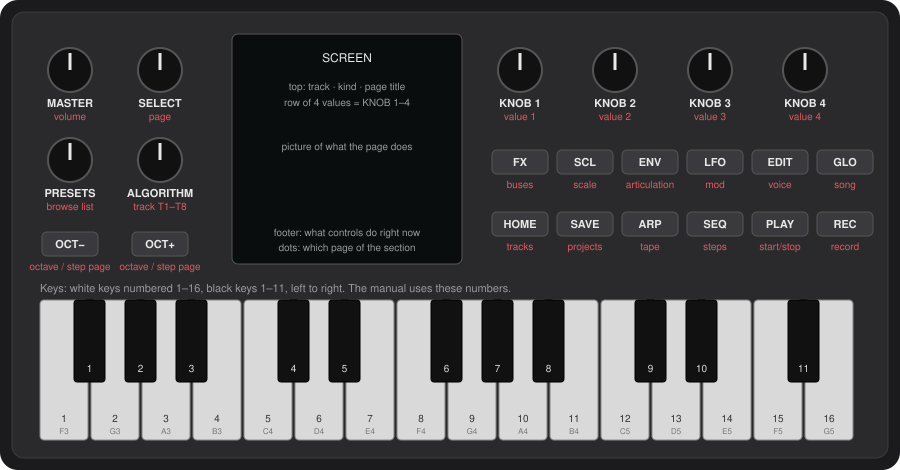</p>

| Control | What it does in Ravel |
| --- | --- |
| **MASTER** | Output volume |
| **SELECT** | Moves to the next page (turn right) or back to the previous one (turn left) in the section you are in |
| **ALGORITHM** | Picks the track you are working on, **T1 to T8**. The keys play this track. |
| **PRESETS** | Browses the list that belongs to the page: sounds on most pages, patterns on SEQ, scenes on SONG, slots on SAVE (projects or sounds), steps on GRAPH, routes on INFLUENCE. The footer tells you which. |
| **KNOB 1–4** | Change the four values in the row at the top of the screen, left to right |
| **OCT− / OCT+** | Move the keyboard down or up an octave. On SEQ pages they move between step pages (1–16, 17–32, …). On pages with more settings than knobs they move the knobs to the next row instead; those pages show the rows on screen, number the knobs, and the footer says what OCT brings next: a kit's **LANE** pages (machine parameters, then LEVEL, CHANCE, LENGTH), the CZ's **DCO, DCW and DCA** envelopes (two stages at a time, then SUS and END), and **LFO SHAPE** (LFO 1 or LFO 2). |
| **10 section buttons** | Each one opens a section (a group of pages). Tap it again for the section's next page. |
| **PLAY** | Starts and stops the sequencer |
| **REC** | Tap to arm recording on the current track |
| **Keys** | Play the current track, or act as steps, scenes or switches depending on the page and on what you hold |

The section buttons:

| Button | Section | What lives there |
| --- | --- | --- |
| **HOME** | Tracks | All eight tracks at a glance, and the influence grid |
| **EDIT** | Voice | The current track's sound: engine, source pages, pitch, filter, skin, insert, mix, sends |
| **ENV** | Articulation | How a note starts, holds and ends, the FILTER ENV, and the step envelopes (STEP ENV, LIBRARY) |
| **LFO** | Mod | Mod matrix, the two LFOs, dust, macros |
| **FX** | Buses | Delay, space, BED, feedback, master |
| **SCL** | Scale | Root, scale, transpose, interval |
| **ARP** | Arp | The current track's arpeggiator: mode, rate, octaves, hold (also a sustain with the arp off); gate, repeat, chance |
| **SEQ** | Steps | Steps, tempo, step timing and shape, track settings, direction, graph and playheads |
| **GLO** | Song | Mixers, the clock (tempo first), scenes, arrangement, density arcs, CPU |
| **SAVE** | Projects and sounds | Save, load, demos, new project; your own sound bank |

> **Section or layer?** A quick **tap** (less than about half a second) opens the section. **Holding** a button and using keys or knobs while it is down turns it into a *layer* instead: SEQ held makes the keys steps, LFO held puts the macros on the knobs, and so on. When you use a button as a layer, letting go of it does not change the page. See [Hold layers](#15-hold-layers).

### Reading the screen

<p align="center">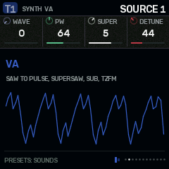</p>

- **Top bar:**
  - **left:** the track (T1–T8, its badge coloured by kind: white synth, slate strike, maroon perc), its kind and engine;
  - **right:** the page title, and on the FM-1 the audio load (**CPU 43%** with a thin bar, held a moment at its peak; amber from 75%, red from 90%). The emulator doesn't measure it, so it doesn't show there.
- **Value row:** a strip divided into four cells, one for each physical knob, always KNOB 1, 2, 3 and 4 in that order. Each cell has a small dial, the name and the value, and a bar showing where it sits in its range; bipolar values have a centre mark. An empty cell keeps its dividers, so you can see which knobs do something on the page. A greyed name and value means that knob does nothing with the track set as it is.
- **Picture:** what the page does, drawn live (a waveform, a filter curve, the step grid, the graph). Tracks keep their kind's colour in the pictures (their meters, waves and steps); what belongs to no one track (the buses, the graph's two heads, the two WAVE tables) is drawn in white and greys with bone and verdigris.
- **Footer:**
  - **left:** what the controls do *right now*. It changes when you hold a button, so read it whenever you are unsure.
  - **right:** small dots, one per page in the section, with the current one lit; then, on the FM-1, the battery: three bars, red and empty when it runs low, or a bolt while USB powers it (the reading means little then).
  - **Also shown:** a play indicator while running, and a red dot when recording is armed.

Short messages ("CAUGHT", "PATTERN B", "SAVED TO 3") flash on the screen when something happens.

## 3. The five moves (how every page works)

Every page in Ravel works the same way:

1. **Press a section button** to open the section.
2. **Turn SELECT** (or tap the same button again) to walk its pages. On FX, tapping FX again jumps to the next bus (DELAY, SPACE, BED, FEEDBACK, MASTER); SELECT still goes page by page.
3. **Turn ALGORITHM** to choose which track you are editing.
4. **Turn KNOB 1–4** to change the four values shown.
5. **Turn PRESETS** to browse whatever the page holds.

Knobs speed up when you turn them quickly, so a fast turn crosses a whole range and a slow turn moves one step.

**Pages appear and disappear.** A section only shows the pages that apply to the current track:

- a VA synth has three SOURCE pages, FM has four;
- the graph's HEAD pages only appear when the track is in GRAPH mode, and HEAD 2's pages only when head 2 is on.

So if a page seems to be "skipped", it is hidden because it does not apply to this track. Change the track or the setting and it comes back.

**Greyed-out knobs.** When a knob does nothing with the track set as it is, its name and value turn grey. For example, on a strike track with the PING body, DAMP, INHARM, GEOMTRY and MODES are grey, because a ping filter has none of those. The value is kept, so it is ready if you change the setup. So are ENGINE and VELO on strike tracks (engines are for synth tracks; strike takes velocity as it comes), T DECAY until TRANS is up, RING F until RING is up, ORDER, RATE and SEED except with the DUST or RAIN exciter, and on PHYS, POSITN for BLOWN and MEMBRAN.

## 4. How the parts connect

<p align="center"></p>

Ravel has **8 tracks**. Each track is one of three kinds, and any track can be any kind (HOME › TRACKS › KIND); T8 can also be the COMP, the mix's compressor:

| Kind | What it is | Default tracks |
| --- | --- | --- |
| **SYNTH** | An oscillator voice with thirteen engines: VA, CZ, FM, PHYS, FORMANT, PARTICLE, CHIP, WAVE, LOGIC, ORGAN, MONO, RESIN, TINE. Up to 4 voices. | T1–T4 |
| **STRIKE** | An exciter hitting a resonant body: drums, metal, wood, rain on glass | T5–T6 |
| **PERC** | A drum machine: 33 machines after the Elektron Machinedrum (TRX, EFM, P-I, GND). It starts as a KIT, six machines in lanes sequenced together on one track; MODE SINGLE is one machine played by notes. | T7 (a kit), T8 (one drum); any track can be PERC |
| **COMP** | T8 only, and only when you choose it: not a voice, but a bus compressor on the main mix (see [T8 as COMP](#t8-as-comp-the-bus-compressor)) | – |

How the sound flows:

1. **Each track** makes sound. On synth, strike and perc tracks the sound goes: source → filter → skin (drive, fold, bits) → insert effect → articulation (the amplitude envelope) → level and pan.
2. **The mixer** adds the tracks together. Each track also **sends** some of its sound to the three **buses** (delay or grains, space, feedback), and the buses return into the mix.
3. **The COMP** (when T8 is one) squeezes the mix. **The master** applies drive and microcuts, then a safety limiter, then goes to the output.
4. **Influence** connects tracks to each other. One track's notes or audio can trigger, modulate, excite, ring or clock another (HOME › INFLUENCE).
5. **The sequencer** plays every track from its own pattern. The **modulation** (LFOs, dust, matrix, macros) moves parameters over time. **Scenes** and the **arrangement** switch patterns and states.

## 5. HOME: tracks and influence

### TRACKS

<p align="center">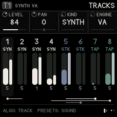</p>

The overview shows all eight tracks:

- each track's number and kind;
- a live level meter;
- how many voices it is using;
- along the bottom, the influence routes drawn as lines.

The current track is highlighted.

| Knob | Value |
| --- | --- |
| 1 **LEVEL** | Track volume, 0–127 |
| 2 **PAN** | −64 left to +63 right |
| 3 **KIND** | SYNTH, STRIKE or PERC (on T8 also COMP). **Changing it resets the track to that kind's defaults.** |
| 4 **ENGINE** | For synth tracks: VA, CZ, FM, PHYS, FORMANT, PARTICLE, CHIP, WAVE, LOGIC, ORGAN, MONO, RESIN, TINE |

**ALGORITHM** picks the track; **PRESETS** loads a sound of the track's kind.

### T8 as COMP: the bus compressor

<p align="center">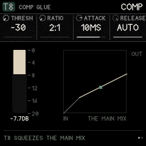</p>

T8 can be a glue compressor for the whole mix, after the SSL G-series bus compressor. It is off by default (T8 is a drum). To turn it on, choose T8 with ALGORITHM, and on HOME › TRACKS (or EDIT › SOUND) turn **KIND** to **COMP**. T8 then plays nothing itself: EDIT shows the compressor's two pages, and it squeezes the mix (the tracks and the buses' returns) before the master's drive and limiter. To turn it off, turn KIND back (it is also KNOB 3 on COMP 2).

| Page | KNOB 1 | KNOB 2 | KNOB 3 | KNOB 4 |
| --- | --- | --- | --- | --- |
| **COMP** | THRESH: −30 to 0 dB | RATIO: 2:1, 4:1, 10:1 | ATTACK: 0.1, 0.3, 1, 3, 10, 30 ms | RELEASE: 0.1, 0.3, 0.6, 1.2 s, or AUTO |
| **COMP 2** | MAKEUP: 0–15 dB | MIX: 0–100 % (below 100, the dry mix under it: parallel compression) | KIND | – |

The meter falls from the top as it squeezes (0 to 20 dB of gain reduction); beside it, the curve it squeezes by, with the mix's level now as a dot. **AUTO** releases in two stages, as the SSL's does: quickly after a short peak, slowly out of a long squeeze. For glue, start at 2:1 or 4:1, ATTACK 10 or 30 ms, RELEASE AUTO, and lower THRESH until the meter moves 2 to 4 dB on the loudest hits. It costs almost nothing: the level is read once per 16 samples.

The matrix and macros can move its knobs like any track's (THRESH on an LFO pumps). A scene or a sound loaded onto T8 can change its kind like any track's.

### INFLUENCE

<p align="center">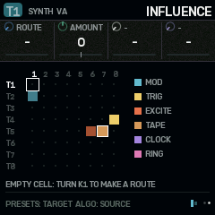</p>

An 8 × 8 grid: rows are **sources**, columns are **targets**. Each filled cell is a route, coloured by type.

1. Turn **ALGORITHM** to the source track (its row is highlighted).
2. Turn **PRESETS** to the target column (the box moves along the row).
3. Turn **KNOB 1 (ROUTE)** to choose what the route does. An empty cell says "TURN K1 TO MAKE A ROUTE".
4. Set the other knobs. They change name to suit the route.

| Route | What happens | KNOB 2 | KNOB 3 | KNOB 4 |
| --- | --- | --- | --- | --- |
| **MOD** | The source's envelope moves one of the target's parameters, every time the source plays | AMOUNT (±) | PARAM: which of the target's parameters | – |
| **TRIG** | Each note on the source also plays the target, with the same pitch | AMOUNT (below 0 plays the target softer) | DELAY: 0–16 steps later | CHANCE: 0–100 % |
| **EXCITE** | The source's audio feeds into the target's body or string (best into a strike or PHYS track) | AMOUNT | – | – |
| **CLOCK** | Each source note moves the target's sequencer one step (René-style: rhythm drives rhythm) | AMOUNT | – | – |
| **RING** | Ring modulates the target with the source's audio | AMOUNT | – | – |
| **SPARK** | Each source hit taps the target's body: a strike track rings at its last note, with no exciter and no attack of its own, and plays no note (so it starts no chain of its own). Only strike tracks can be sparked | AMOUNT: how hard the tap | – | – |

To remove a route, turn KNOB 1 back to `-`.

A trigger chain never plays the same track twice in one pass, so routes can form loops safely (T1 triggers T2, which triggers T1).

## 6. EDIT: the voice

All pages here act on the current track (ALGORITHM). **PRESETS** browses sounds for the track's kind on every voice page; the sound's name flashes on screen. A preset doesn't touch the track's sends into the effects (FX): they stay where you set them.

| Page | KNOB 1 | KNOB 2 | KNOB 3 | KNOB 4 |
| --- | --- | --- | --- | --- |
| **SOUND** | KIND | ENGINE | VOICES (mono, 2, 3, 4) | VELO: how much key velocity changes the level |
| **SOURCE 1–4** | the engine's own controls, see below | | | |
| **OSC MIX** | each oscillator's level, side by side: VA OSC LVL, SUB, NOISE · FM LEVEL1–4 · WAVE LEVEL 1, ASIC · CHIP OSC LVL, SUB · MONO SAW, PULSE, SUB, NOISE | | | |

OSC MIX appears on engines with more than one sound source. **OSC LVL** (LEVEL1 on FM, LEVEL 1 on WAVE) is the first oscillator's own level, new here; the others are the engine's existing level knobs, shown together (they stay on the SOURCE pages too). The CZ's two lines are levelled by their DCA envelopes, ORGAN's by its rank footages.
| **PITCH** | PITCH (±24 semitones) | FINE (±50 cents) | GLIDE | VCF KEY: the filter's cutoff (or a Z filter's morph) follows the note |
| **FILTER** | FILTER type: LADDER, LOWPASS, BANDPASS, HIGHPASS, LPG, MS-20, SH-101, and six Z filters (Z VOWEL, Z TALK, Z PHASER, Z PEAKS, Z SWEEP, Z METAL) five XT filters (XT LP24, XT BP24, XT NOTCH, XT S&H, XT SHAPE) and SEM | CUTOFF (Hz); on a Z filter, MORPH | RESO; on a Z filter, XFORM | ENV>CUT: how much the FILTER ENV opens the filter (±); the same setting as on ENV › FENV ROUTE, so turning either moves both |
| **SKIN** | DRIVE (saturation of everything the track plays at once: 0 by default, so chords stay clean; turn it up to make them break up together) | FOLD (wavefolding) | BITS (bit reduction) | – |
| **SKIN 2** | BITMASK (digital grit) | DEREZ (sample-rate reduction) | GRAIN (strike and perc tracks): each hit a little different, see below | – |
| **INSERT** | INSERT effect: OFF, COMB, SHIFT, CRUSH, SMEAR | TUNE: on COMB its note (C4 at the middle, a semitone a step); on SHIFT the shift | AMOUNT | MIX |
| **MIX** | LEVEL | PAN | DELAY send | SPACE send |
| **SENDS** | FEEDBK send | DELAY send | SPACE send | – |

<p align="center">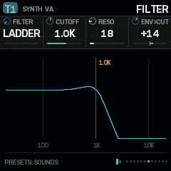 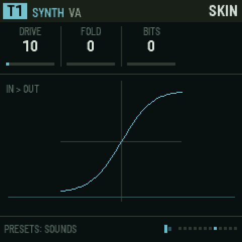 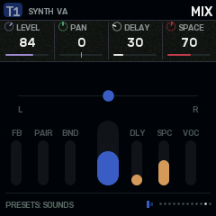</p>

**MS-20** is hot and dirty: a two-pole filter whose resonance runs through clipping diodes, with the input driven. Turned up, it barks, then screams. **SH-101** is round and liquid: four smooth stages whose resonance sings rather than bites, and keeps its bass as it rises.

**The Z filters** morph, in the manner of E-mu's Z-plane filters (Morpheus, the Audity, the later samplers). Each is twelve poles: six sections, peaks, dips and slopes, laid out at the four corners of a square. CUTOFF becomes **MORPH**, which moves across the square one way, and RESO becomes **XFORM**, which moves it the other. In between, every peak glides at once, so the whole shape turns into the next one rather than a single cutoff moving. The filter envelope (ENV), VCF KEY, the LFOs and the matrix move MORPH like any cutoff. The FILTER picture draws the real response as it morphs. The shapes are Ravel's own:

| Type | MORPH (0 to 127) | XFORM (0 to 127) |
| --- | --- | --- |
| **Z VOWEL** | "ah" to "ee" | a lower, softer voice to a higher, sharper one |
| **Z TALK** | "oo" to "ae": a talk box, best moved by the envelope | to "aw" and "er": tighter, more nasal |
| **Z PHASER** | six notches sweeping up from low to high | from plain notches to notch-and-peak pairs: a phaser with its feedback up |
| **Z PEAKS** | six resonant peaks rising together | from broad and glassy to narrow and ringing |
| **Z SWEEP** | closed (a steep twelve-pole lowpass) to open | from smooth to a resonant peak riding the slope |
| **Z METAL** | one set of clangorous, inharmonic peaks to another | from struck to long and ringing |

Try the TALK BOX, PHASE PAD, Z VOX and Z SWEEP presets. The Z filters are on synth tracks, on any engine.

**SEM** is after the Oberheim SEM: a single 12 dB state-variable filter, open and creamy rather than fat, whose resonance rises to a vocal peak but never quite self-oscillates. Choosing it adds a **SEM** page after FILTER: **LP-HP** sweeps continuously from low pass (0) through a notch (64) to high pass (127), and the matrix and LFOs can move it; **BP** switches to its band pass, which grows louder as RESO rises (LP-HP is then greyed); CUTOFF and RESO are repeated there. Try the SEM BRASS and SEM NOTCH presets.

**The XT filters** are digital filters in the manner of the Waldorf Microwave II/XT's: **XT LP24** is a clean four-pole lowpass whose resonance rings sharp and glassy, **XT BP24** a four-pole bandpass, **XT NOTCH** cuts a hole at CUTOFF (RESO widens and deepens it), **XT S&H** samples and holds the sound at a rate CUTOFF sets (a sample-rate reducer that follows the keys with VCF KEY; RESO keeps more of the raw steps) and **XT SHAPE** is a wave shaper, CUTOFF driving it and RESO folding it further. They suit the WAVE engine but work on every synth engine.

The filter belongs to synth voices. On strike tracks the FILTER page's knobs are greyed out.

**LPG** is a low-pass gate: the filter closes as the note fades, so sounds get darker as they die away (good for plucks and Buchla-style bongos).

Changing **ENGINE** resets the SOURCE values to that engine's defaults. Use PRESETS to start from a finished sound instead.

**GRAIN** (EDIT › SKIN 2, on strike and perc tracks) makes each hit slightly different from the last: a little sharper or flatter (up to half a semitone), a little louder or softer, now and then darker or shorter. Most hits move a little and a few a lot, the way a hand never strikes twice the same. It changes nothing about which steps play or when: it is texture, so sixteen hats sound like sixteen hits instead of one copied. On a kit it acts on every lane.

### The thirteen synth engines (SOURCE pages)

**VA (virtual analog):** the familiar subtractive oscillator, and more.

| SOURCE 1 | SOURCE 2 | SOURCE 3 |
| --- | --- | --- |
| WAVE: saw through to pulse | SUB: sub-oscillator level | SYNC: hard-sync sweep |
| PW: pulse width | NOISE level | DRIFT: slow analog wander |
| SUPER: 1–7 stacked oscillators (supersaw) | TZFM: through-zero FM depth | |
| DETUNE: spread of the stack | FMRATIO: modulator ratio (1/2 to 7) | |

**CZ:** a full Casio CZ (the CZ-101, 1000, 3000, 5000 and CZ-1 all share this voice). It works as the CZ's own sound chip does: a cosine read through a bent phase, where **DCW** is how bent it is (at 0 every wave is a sine). Each note plays one or two **lines**, and each line has two waves and three 8-step envelopes: **DCO** (pitch), **DCW** (waveform) and **DCA** (level). Ravel's filter, skin, inserts, LFOs and matrix all still work on top.

General settings, on the SOURCE pages:

| SOURCE 1 | SOURCE 2 (detune: line 2) | SOURCE 3 (vibrato) | SOURCE 4 |
| --- | --- | --- | --- |
| LINE: **1**, **2**, **1+1'** (line 1 twice, the second detuned), **1+2'** (both lines, line 2 detuned) | DETUNE: + or - | VIB WAV: TRI, SQUARE, UP, DOWN | DCW +-: shifts both lines' DCW; give it an LFO in the matrix to sweep the timbre (the CZ itself could not) |
| OCTAVE: -1, 0, +1 | DT OCT: 0–3 octaves | DELAY before it starts (0–99) | FOAM: takes the fundamental out, leaves the sidebands |
| MOD: OFF, RING (line 2 times line 1), NOISE (line 2's pitch kicked by noise) | DT NOTE: 0–11 semitones | RATE (0–99) | VEL DCW: how much a softer touch closes DCW (0–9, CZ-1 style) |
| CHORUS: OFF, I, II, I+II (Juno-60 style) | DT FINE: 0–60 (60 = a semitone) | DEPTH (0–99; 0 = none) | – |

Then, per line (LINE 1, LINE 2):

| KNOB 1 | KNOB 2 | KNOB 3 | KNOB 4 |
| --- | --- | --- | --- |
| WAVE 1: SAW, SQUARE, PULSE, DBL SIN, SAW PLS, RESO 1 (saw window), RESO 2 (triangle), RESO 3 (trapezoid) | WAVE 2: OFF, or a second wave | DCA KF: the level envelope runs faster on higher notes (0–9) | DCW KF: higher notes are duller (0–9) |

And the envelopes, DCO 1, DCW 1, DCA 1 (and DCO 2, DCW 2, DCA 2):

Each envelope page holds all eight stages. **OCT+ and OCT−** move the four knobs through five rows; the picture lights the two stages on the knobs and marks them with the knob numbers (1 2, 3 4), and the footer says what OCT+ brings next. PRESETS still picks a sound.

| OCT row | KNOB 1 | KNOB 2 | KNOB 3 | KNOB 4 |
| --- | --- | --- | --- | --- |
| 1 (stages 1–2) | RATE 1: how fast stage 1 moves (0–99) | LEVEL 1: the level it moves to (0–99) | RATE 2 | LEVEL 2 |
| 2 (stages 3–4) | RATE 3 | LEVEL 3 | RATE 4 | LEVEL 4 |
| 3 (stages 5–6) | RATE 5 | LEVEL 5 | RATE 6 | LEVEL 6 |
| 4 (stages 7–8) | RATE 7 | LEVEL 7 | RATE 8 | LEVEL 8 |
| 5 | SUS: the stage the envelope holds while the key is down (OFF, 1–8) | END: its last stage (1–8) | – | – |

Stages after END are drawn dim: they keep their settings but don't play until END reaches them (set END to 8 to use all eight).

- **How an envelope runs:** from step 1, each step moves at its RATE to its LEVEL, then the next step starts. At the SUS step it waits while the key is held; when you let go it goes on from the step after SUS. It stops at END. Rates and levels follow the CZ's own curves: rate 99 is a few milliseconds, rate 0 almost forever; DCA levels are on the CZ's logarithmic scale.
- **DCO levels:** up to 63 the pitch rises in 6.25-cent steps (63 is almost 4 semitones); from 64 it jumps in 2-semitone steps (64 is 8 semitones, 99 is 78). The DCO envelope can only raise the pitch, as on the CZ.
- **Two waves on a line** alternate cycle by cycle, so the note sounds an octave lower with a mix of both characters (the CZ's "cascade"). Two RESO waves cannot be combined, as on the CZ.
- **RESO waves** are a sine whose frequency rises with DCW, restarting every cycle under a falling window: like sweeping a resonant filter, with no filter.
- **High notes** narrow DCW automatically, as the CZ does, so thin pulses stay audible.
- **The DCA is the level envelope.** On a CZ track the ARTICULATION pages' shape knobs are greyed out; the envelope's DESTINATIONS and the influence routes follow the DCA instead; the filter has its own FILTER ENV.
- **The pictures:** LINE pages draw the line's two cycles at its brightest DCW. Envelope pages draw the 8 stages, the SUS and END points, the two stages on the knobs (white, numbered with their knobs) and where the playing note is (amber dots).
- **Presets:** CZ BRASS, CZ BELL (ring-modulated lines a twelfth apart), CZ STRINGS, RESO SWEEP, CZ BASS, NOISE HIT and FOAM.
- **Projects from before the CZ** load with each CZ track set to a plain CZ tone.


**FM:** 4 operators.

| SOURCE 1 | SOURCE 2 | SOURCE 3 | SOURCE 4 |
| --- | --- | --- | --- |
| ALGO: 12 routings (shown as `1>2>3>4` and so on; `>` means "modulates", `+` means "mixed") | RATIO3 | LEVEL4 | WAVE4 |
| FEEDBK: operator 1 feedback | RATIO4 | WAVE1 | MOD DEC: how fast the modulators fade (the classic FM "pluck") |
| RATIO1 | LEVEL2 | WAVE2 | TZFM: through-zero FM |
| RATIO2 | LEVEL3 | WAVE3 | VEL MOD: velocity brightens the sound |

Each operator can be SINE, TRI, SAW, SQUARE, HALF, ABS, QUART or BITS.

**PHYS (physical modelling):** a virtual instrument that you strike, bow or blow.

| SOURCE 1 | SOURCE 2 |
| --- | --- |
| MODEL: STRING (plucked), BOWED, BLOWN, MEMBRAN (drum skin) | EXCITE: how hard it is played: pluck strength, bow speed, breath |
| BRIGHT: brightness of the excitation | INHARM: detunes the overtones (metallic); on BOWED, lighter bow pressure (scratchier, airier) |
| DAMP: how quickly highs die | BODY: resonance of the body (not MEMBRAN) |
| POSITN: where it is plucked or bowed (STRING, BOWED) | DECAY |

BOWED and BLOWN keep sounding for as long as the key is held, like a violin or a clarinet. BLOWN speaks an octave lower in character (a clarinet's hollow, odd-harmonic tone) but plays the note you press.

**FORMANT:** vowels and voices.

| SOURCE 1 | SOURCE 2 |
| --- | --- |
| VOWEL: sweeps A-E-I-O-U | BREATH: air in the voice |
| SHIFT: moves the formants (smaller or bigger "throat") | GLOTTAL: the shape of the pulse |
| WIDTH of the formants | SPREAD: stereo or choir spread |
| MODE: FILTER (a filter bank on a pulse) or FOF (grain-based, more vocal) | VIBRATO |

**PARTICLE:** pulsars. Short bursts of a waveform at the note's pitch that can pull each other into sync.

| SOURCE 1 | SOURCE 2 |
| --- | --- |
| TABLE: SINE, GLASS, REED, VOICE, BELL, BITS, NOISE, DROP | COUPLE: how strongly the emitters pull into sync |
| DUTY: burst length (short = buzzy, long = tonal) | MASK: drop bursts at random |
| EMIT: 1–3 emitters | FORMANT: the burst's own pitch |
| RATIO between emitters | SCATTER: timing randomness |

**CHIP:** a glitchy chiptune voice, after the Syntakt's SY CHIP. A SID-style oscillator steps through the note you play and up to three offsets at RATE, so one voice plays a fast arpeggio, a chord or a "complex voice". A square sub oscillator sits under it, and a decompose stage after it reduces, crushes and breaks the sound apart.

| SOURCE 1 | SOURCE 2 | SOURCE 3 | SOURCE 4 (decompose) |
| --- | --- | --- | --- |
| WAVE: TRI, SAW, PULSE, NOISE (the SID's noise register), SAW&PUL (the SID's combined wave), RING (a ring-modulated triangle), PWM (the width sweeps by itself), KICK and SNARE (drum tables) | OF2: the arp's second note, in semitones | SUB: a square sub oscillator on the note you play (it does not follow the arp) | SRR: sample-rate reduction (aliasing, grit) |
| PW: pulse width (on RING, the ring partner's ratio; on PWM, how far it sweeps) | OF3: the third note | SUB OCT: the sub's octave, -3 to +1 | CRUSH: bits, 16 (clean) down to 1 |
| RATE: how fast the arp steps, 2–128 steps a second (classic chip arps are around 50) | OF4: the fourth note | SYNC: the main oscillator restarts with the sub (hard sync), so as the arp moves the notes, the timbre sweeps | DECOMP: how often the sound breaks |
| MODE: UP, DOWN, PINGPNG, RANDOM, ONCE (up through the notes, then stays) | STEPS: how many of the root, OF2, OF3 and OF4 the arp walks (1 = no arp) | OVER: overdrive | FRAG: the size of each piece, 1.5–46 ms |

- **The arp:** for a minor chord, set OF2 +3, OF3 +7, OF4 +12 and STEPS 4. Multiples of 12 jump octaves. RATE, MODE and the offsets grey out while STEPS is 1.
- **Sync:** with SYNC on and SUB OCT at -1, the sub holds the root while the arp's notes become synced, tearing timbres over it (the SYNC ARP preset). SUB OCT greys out while SUB is 0 and SYNC is off.
- **Decompose:** the voice keeps its last 46 ms. At the end of each fragment, DECOMP is the chance that the next one breaks: the last fragment repeats, plays backwards, drops out, has its bits flipped, or plays at double speed. FRAG greys out while DECOMP is 0.
- **Presets:** CHIP ARP, SID BASS (through the MS-20 filter), CHIP KICK, CHIP SNARE, DECOMPOSED and SYNC ARP.

**WAVE:** a wavetable synth after the PPG Wave and the Waldorf Microwave. Two oscillators each read a wavetable: 8 key waves, with POS moving through 64 positions between them. Osc 1 can sync, ring-modulate or frequency-modulate osc 2, both read through a phase warp (after Serum's), and a mixer adds a sweet saturation as you push it. The wave envelope sweeps the positions in a loop, as the Microwave's does. ASIC dials in the hardware: from smooth to the PPG's stepping to the early Microwave's sizzle. The 20 tables are Ravel's own, built in the families the PPG made famous; none come from a PPG or Waldorf ROM.

| SOURCE 1 | SOURCE 2 | SOURCE 3 | SOURCE 4 |
| --- | --- | --- | --- |
| TABLE 1: osc 1's wavetable | SEMI 2: osc 2's interval, ±24 semitones | XMOD: OFF, SYNC (osc 2 restarts with osc 1), RING, FM (osc 1 bends osc 2's phase), SYNC+FM | WAVE ENV: OFF, or one of 32 shapes (PLUCK, SWELL, STAIRS and the rest) that sweeps both positions |
| POS 1: where in the table (0–63) | DETUNE: osc 2 a little sharp | XM AMT: how much | WE AMT: how far it sweeps (±63 positions) |
| TABLE 2: osc 2's wavetable | MIX: osc 1 to osc 2 (0 = osc 1 alone) | WARP: OFF, SYNC, BEND, PWM, MIRROR, REMAP 2, REMAP 4, SQUEEZE, FLIP, QUANT | WE TIME: one pass of the wave envelope |
| POS 2 | SAT: the mixer's saturation | WARP AMT | VELO: velocity sensitivity (on WAVE it lives here; its place on SOUND holds MIX) |

- **The tables:** PPG SWEEP (sine to saw, harmonic by harmonic), RESONANT (a resonant peak climbing), PULSE (wide to thin), SYNC (a synced sweep), VOICES (vowels), ORGAN (drawbar settings), BELLS, FORMANT, DIGITAL (bit patterns), SQR TO SAW, PARTIALS (one harmonic walking up), OCTAVES, FM (an index sweep), BRASS, STRINGS, PPG HARD, RANDOM, CHOIR, E-PIANO and WAVEFOLD.
- **The warps:** SYNC squeezes several cycles into one; BEND leans the wave left or right; PWM squeezes its first half; MIRROR plays it forward then back; REMAP 2 and 4 blend in the wave read two or four times a cycle; SQUEEZE pinches it toward the middle; FLIP turns the end of the cycle upside down; QUANT steps the phase (bit-crushed reading).
- **The wave envelope** loops while the key is held, then finishes its pass. Pair it with a slow WE TIME for evolving pads, or a fast one with STUTTER or STAIRS UP for rhythmic wave sequences. POS 1 and POS 2 are modulation destinations too: an LFO on POS is the classic PPG sweep.
- **Greyed knobs:** osc 2 is only heard through MIX (or RING, which multiplies it into osc 1), so osc 2's knobs grey out while MIX is 0 and XMOD isn't RING, and so does XM AMT for SYNC and FM, which change osc 2: turn MIX up to hear them. XM AMT also greys while XMOD is off; WARP AMT while WARP is off; WE AMT and WE TIME while WAVE ENV is off.
- **Where MIX, VELO and ASIC sit:** on a WAVE track, SOUND's fourth knob is **MIX** (so bringing in table 2 is one turn from the first page), VELO moves to SOURCE 4's fourth knob, and **ASIC** sits on OSC MIX beside LEVEL 1: 0 smooth; 1–63 the positions step through 64 whole waves (the PPG's zipper); 64–127 raw, unsmoothed reading, a truncated phase and a coarser output (sizzle). MIX also stays on SOURCE 2.
- **The picture:** table 1's waves stacked back to front, the one playing lit in POS 1's knob colour. With MIX up, table 2 is drawn below it the same way, lit in POS 2's colour, each stack half as deep.
- **Presets:** PPG PAD, WAVE BELLS, MW SYNC, DIGI BASS, VOX SWEEP and REMAP STEP.

**LOGIC:** oscillators built out of function blocks, after Kurzweil's VAST, whose FUNs compute a function of two signals, and E-mu's patch-cord functions. Three simple sources play: **A** on the note, **B** and **C** at musical ratios of it. **OP 1** combines A and B, then **OP 2** combines that with C. The functions range from arithmetic to bit logic, so the result can be anything from a soft sum to a broken digital pattern that repeats at the sources' common period. A pitch-synchronous grain stage can then turn it into a granular wave: every cycle it plays a grain of the voice's own last few milliseconds.

| SOURCE 1 | SOURCE 2 | SOURCE 3 | SOURCE 4 |
| --- | --- | --- | --- |
| A WAVE: SAW, TRI, SQUARE, SINE, PULSE, NOISE | C WAVE | BITS: the word size the bit operators and QUANT work in, 1–12 (fewer is cruder) | SMOOTH: rounds off the hard edges (the engine also runs at twice the rate to keep them cleaner) |
| B RATIO: 1/4 to 16 times A | OP 1: how A and B combine | PW: the width of any PULSE source | GRAIN: 0 off; short grains leave gaps (pulsar-like), long ones overlap into a cloud |
| B WAVE | OP 2: how OP 1's result and C combine | B DRIFT: B up to 30 cents off its ratio, so the pattern slowly turns | G SPRAY: how far back, at random, each grain starts |
| C RATIO | OP 2 AMT: how much of OP 2 (0 = OP 1 alone) | DRY A: mixes A itself back in | G PITCH: the grains' content transposed, ±24 semitones (the period stays on the note) |

- **The functions:** A+B (a sum), A\*B (ring modulation), MIN and MAX (the lower or higher of the two), AND, OR, XOR and NAND (the two as BITS-bit numbers, combined bit by bit), A>B (a comparator: high where A is above B, so two slightly detuned sources make a pulse whose width sweeps), GATE (A only while B is high), DIFF (how far apart they are), QUANT (A in steps that B sets), MOD (A wrapped around a size B sets), SIN(A+B) (a sine of the sum: phase modulation) and A(B) (A's wave read at the position B gives: waveshaping).
- **Where to start:** XOR or NAND between a SAW and a TRI at a ratio of 3/2 or 2, then fewer BITS for a cruder pattern. A>B between a SINE and a TRI at ratio 1 with a little B DRIFT gives a slowly breathing pulse. Ratios that aren't whole numbers make the pattern repeat at a lower common period, so the pitch can drop: 3/2 sounds an octave down, for example.
- **Greyed knobs:** C, OP 2 and C RATIO grey out while OP 2 AMT is 0; BITS while no bit operator or QUANT is in use; PW while no source is PULSE; G SPRAY and G PITCH while GRAIN is 0.
- **Presets:** LOGIC XOR, COMPARATOR, GRAIN VOX and BIT CRUNCH.

**ORGAN:** a pipe organ played like a synthesizer, after the euphoric, breathing organ records of Maxime Denuc (Nachthorn, made on a computer-controlled church organ). Seven ranks of pipes, one per footage, sound together over one stop family, and each pipe behaves like a pipe: it speaks a moment after the key, comes in slightly flat and with a puff of air (the chiff), and the wind that feeds it is never quite steady. The pipe spectra are Ravel's own, from harmonic recipes; there are no samples. The church is the SPACE bus: set its MODE to CLOUDS and turn DECAY up for the long, stone-room tail, and give the track plenty of SPACE send (the ORGAN presets do).

| SOURCE 1 | SOURCE 2 | SOURCE 3 | SOURCE 4 |
| --- | --- | --- | --- |
| STOP: FLUTE (stopped, nearly pure), NACHTHORN (a wide open flute, hollow and soft), PRINCIPAL (the bright, even organ tone), GAMBA (a string stop), TRUMPET (a reed) | 2 2/3': the twelfth (a fifth over the 4') | CHIFF: the puff of air as each pipe starts | WIND: the air supply wavers, pitch and level, and pipes sit a few cents apart |
| 16': an octave down | 2': two octaves up | SPEECH: how long a pipe takes to speak, 10 to 150 ms | TREMLNT: the tremulant, a throb in level and pitch |
| 8': the pitch you play | 1 3/5': the tierce (two octaves and a third up) | SPREAD: how far apart the ranks start, up to 35 ms | TREM RT: its speed, 3 to 9 Hz |
| 4': an octave up | 1': three octaves up | AIR: a breath under the tone | CELESTE: a second 8' rank tuned sharp, so it beats (a voix céleste) |

- **Registration:** the seven footage knobs are the drawstops: pull out 8' and 4' for a clear voice, add 2 2/3' and 2' for a bright, singing mixture, 16' for weight. Ranks too high for a note fall silent, as real pipes run out.
- **Playing it:** organs don't respond to how hard you play, so VELO starts at 0. The track's ENV is the swell around it all: leave ATTACK short and let SPEECH do the onset; RELEASE about 100 ms is a pipe letting go. The sequencer's interlocking patterns (two playheads in GRAPH mode, INTERVAL, scenes changing registration via the macros) do what the record's pattern-based organ playing does.
- **Presets:** INFINITE, PLENUM, VOX CELESTE, FLUTE 4' and TROMPETTE.

**MONO:** a monosynth after the Roland SH-101, played like a wind or bowed instrument, after the way Dorian Concept phrases it. One oscillator, as on the 101: saw, pulse and sub all come from the same source, so nothing detunes or thickens. Choosing MONO sets the track up as the 101 does it: one voice, the SH-101 filter, key tracking full, cutoff about 1.1 kHz, resonance about 12%, the envelope opening the filter by about half, and a bowed-or-plucked envelope (22 ms attack, 260 ms decay, sustain about half, 120 ms release).

| SOURCE 1 | SOURCE 2 | SOURCE 3 | SOURCE 4 |
| --- | --- | --- | --- |
| SAW: its level | NOISE | SCOOP T: how quickly the scoop arrives | VEL>CUT: a harder note opens the filter further |
| PULSE | PW: the pulse's width | VIBRATO: depth, up to 50 cents | DRIFT: the pitch breathes a few cents |
| SUB: the sub oscillator's level | PWM: the vibrato's LFO moves the width | VIB RATE: 1 to 9 Hz | RETRIG: LEGATO (overlapping notes slur: the envelope carries on and GLIDE slides) or ALWAYS (every note starts again) |
| SUB OCT: -1 OCT, -2 OCT, -2 PULSE (a quarter-width pulse, as on the 101) | SCOOP: a detached note starts below and bends up into pitch, up to 3 semitones | VIB DLY: the vibrato fades in after this long, up to 1.5 s | DRIVE: pushes the oscillator into the filter |

- **Playing it:** overlap notes for slurred phrases (the envelope doesn't restart and GLIDE carries the pitch), lift between notes to articulate them (each starts again, with its scoop). A little vibrato that waits before it starts, and VELO with VEL>CUT, make held notes feel blown or bowed. For layered parts, record one mono line, then another on a second MONO track, as Dorian Concept builds his from many single passes.
- **Presets:** ORGANIC SAW (the settings above with a hint of vibrato), WOODWIND, CELLO LINE, RUBBER BASS and SCOOP LEAD.

**RESIN:** a bowed string or a reed, built to be played hard. Where PHYS models a well-behaved instrument, RESIN is about the edges: the bow pressed until it scrapes, a harmonic touched lightly, a reed overblown into a growl or a split multiphonic. Each note is one player, with vibrato built in, and the **QUAKE** knob shakes the player's hand: the pressure and pitch waver more and more, and at the top the note squeals and breaks. MODEL chooses **BOW** (a bowed string: the bow sticks and slips on the string, and a wooden body rings with it) or **HORN** (a reed on a bore: the breath pushes the reed, which opens and closes the tube). Changing MODEL sets the other knobs to that model's defaults; their names change with it.

| | SOURCE 1 | SOURCE 2 | SOURCE 3 | SOURCE 4 |
| --- | --- | --- | --- | --- |
| **BOW** | MODEL | SCRAPE: noise and grit as the bow slips, more with pressure | VIB RT: vibrato rate, 3 to 9 Hz | QUAKE: the hand shakes; pressure and pitch waver, then squeal |
| | PRESS: bow pressure; past about three quarters, the tone breaks into a raw crunch | HARMON: touch the string lightly at its middle, for the flageolet an octave up | VIB DP: vibrato depth, up to 60 cents | BOW ATK: how quickly the bow gets moving |
| | SPEED: bow speed, the loudness and brightness | BODY: how much the wooden body rings | ONSET: how long the vibrato takes to arrive, up to 2.5 s | ROSIN: grip; more rosin bites harder |
| | POSITN: where the bow meets the string, from the bridge (glassy) to over the fingerboard (soft) | SIZE: violin to cello to bass, the body's resonances | DRIFT: the pitch wanders a few cents | HISS: the bow hair's noise |
| **HORN** | MODEL | GROWL: singing into the horn; the breath beats at half the pitch | (as BOW) | QUAKE |
| | PRESS: breath pressure; more overblows | MULTI: a second reflection in the bore, which splits the note into a multiphonic | | ATTACK: how quickly the breath arrives |
| | REED: the reed's stiffness, soft and buzzy to hard and pure | THROAT: the player's throat, a resonance from 250 Hz to 2 kHz | | KEYS: the click of the keys at each note |
| | BORE: where along the bore the reed sits, which colours the tone | SIZE: the bore, small and bright to large and dark | | AIR: breath noise |

- **Playing it:** the filter is open by default; shape the note with the volume envelope (a slow attack and long release for a bowed line) and VELO. Use one voice and GLIDE for a single player sliding between notes. QUAKE is the performance knob: put it on an LFO, the matrix or a step envelope (STEP ENV) for a hand that gives out on certain steps.
- **Presets:** WRAITH (a low cello, pressed hard, with wide slow vibrato and drift), UPSTAIRS (a frantic, scraping violin line, one voice gliding), RESIN VIOLIN (a cleaner violin), FOGHORN (a low, overblown reed) and THROAT SAX (a growling, sung-into reed).

**TINE:** things that are struck or plucked and then ring: metal tines and wooden bars. Each note is a handful of resonant modes (the bar's or tine's own overtones, which are not the harmonics of a string) set ringing by a short strike; a harder PLUCK, MALLET or HAMMER is a shorter strike, which reaches the higher modes. Choosing TINE opens the track up for it: four voices, the filter open, the envelope held at full sustain so the instrument decays by itself, and velocity at 100. MODEL chooses **KALIMBA**, **MARIMBA** or **EPIANO**; changing it sets the other knobs to that model's defaults, and their names change with it.

| | SOURCE 1 | SOURCE 2 | SOURCE 3 | SOURCE 4 |
| --- | --- | --- | --- | --- |
| **KALIMBA** | MODEL | RUST: old iron tines, out of true: stray partials that die fast, grit in the pluck, a slow beat between the tine's two swings | BOX: the wooden box's resonance | DETUNE: each note a little off, as hand-tuned tines are, up to 40 cents |
| | PLUCK: how sharply the thumb lets go | BUZZ: the metal rings (or bottle caps) on the tines, rattling | HOLE: the sound hole, covered (lower, darker) to open | BEND: a hard pluck starts sharp and settles |
| | DECAY: how long the tines ring | RATTLE: how readily the rings rattle; low, only on hard plucks | WAH: a hand opening and closing the hole, 1 to 8 Hz (0 off) | DAMP: how fast a released note stops (0 lets it ring) |
| | TONE: how long the high partials last | THICK: thick tines, fuller and lower in their overtones | THUMB: the thumbnail's click | DRIFT: the pitch wanders a few cents |
| **MARIMBA** | MODEL | POSITN: where the mallet lands, from the centre (pure) toward the end (more overtones) | ROLL: held notes are rolled, struck again and again (0 off) | DETUNE |
| | MALLET: soft yarn to hard | TUBE: the resonator tube under each bar, which carries the fundamental | ROLL RT: 5 to 24 strokes a second | HUMAN: an uneven roll |
| | DECAY | WOOD: the bar's wood, darker to brighter | BUZZ: a balafon's gourds, their membranes buzzing | DAMP |
| | TONE | STICK: the mallet's click | RATTLE: how readily the gourds buzz | DRIFT |
| **EPIANO** | MODEL | BELL: the tine's bright, quick high partial | TREM: tremolo depth (0 off) | DETUNE |
| | HAMMER: felt soft to hard | BARK: how hard a hard note drives the pickup, for the growl | TREM RT: 1.5 to 9 Hz | KEY OFF: the dampers' noise as a key is let go |
| | DECAY | PICKUP: how far off centre the tine swings past its pickup: more of the second harmonic | DRIVE: the amp breaking up | DAMP: how fast the dampers stop a released note |
| | TONE | TONEBAR: the tonebar's sustain and its slow beat with the tine | THUMP: the hammer's low thud | DRIFT |

- **Playing it:** TINE answers velocity: harder notes are brighter, a kalimba's rings rattle and an electric piano barks. With DAMP at 0 notes ring on after release, like a kalimba or a marimba without dampers; raise it for an electric piano's dampers.
- **Presets:** THUMB PIANO, NAIL KALIMBA (thick, rusty tines with loud rings, an octave down), HAND WAH, MARIMBA, MARIMBA ROLL, BALAFON, SUITCASE (an electric piano with tremolo), GLASS TINE (all bell, little bark) and BARKING EP.

### Strike tracks (SOURCE pages)

A strike is an **exciter** (what hits) and a **body** (what rings).

| SOURCE 1 | SOURCE 2 | SOURCE 3 | SOURCE 4 |
| --- | --- | --- | --- |
| EXCITER: CLICK, NOISE, METAL, FM, DUST, RAIN, BOW, BLOW, EXT (only from outside; DUST and RAIN can take the LFO section's DUST instead, below) | DAMP | ORDER: how the modes are laid out | RING F: ring-mod frequency |
| BODY: PING (filters), MODAL (bars and bells), DISC (cymbals, plates), STRINGS (coupled strings) | INHARM: how un-harmonic the modes are | RATE: for DUST and RAIN, how often grains fall | RING amount |
| DECAY | GEOMTRY: the shape of the body | TRANS: level of the attack transient | P DROP: pitch drop at the hit (toms, kicks) |
| TONE: brightness | MODES: 2–8 resonances | T DECAY: length of the transient | SEED: a different random variation |

With **EXT** as the exciter, the track makes no strike of its own: the body rings only from what comes in from outside. That is another track's sound through an **EXCITE** route (HOME › INFLUENCE), the feedback bus returning into this track, or, in the emulator, a file under Audio in. If nothing is coming in, the SOURCE page says so, and you will hear only the attack layer and the inserts, the same on every note. The body's pitch still follows the notes, so a track exciting it through an EXCITE route rings at the note you play.

### Perc tracks (SOURCE pages)

A PERC track is a drum machine after the **Elektron Machinedrum**. Its 33 machines come from the Machinedrum's four synthesis families. Elektron never published how the Machinedrum makes its sounds, so these are Ravel's own designs, built from what the Machinedrum's manual documents: each machine has the manual's parameters, in its order, doing what the manual says they do. They are not sample-perfect copies; the sampled E12 and ROM machines are left out.

A PERC track has two MODEs (EDIT › SOUND, KNOB 2). It starts as a **KIT**: six machines in lanes, sequenced together on the one track (see *Kits* below). **SINGLE** is one machine played by notes, on the SOURCE pages:

- **SOURCE 1, KNOB 1: MACHINE.** Choosing a machine loads its own defaults.
- **The rest of SOURCE 1 and SOURCE 2:** the machine's own eight parameters (A–H on the Machinedrum). A machine with fewer leaves the rest greyed out.
- **SOURCE 3 and 4: the Machinedrum's track effects.** AMD and AMF (amplitude modulation: depth and rate, up to audio rates), EQF and EQG (a one-band EQ: frequency and boost or cut), FLTF, FLTW and FLTQ (the band filter: a high-pass at FLTF and a low-pass FLTW above it; FLTF at 0 turns the high-pass off, FLTW at 127 the low-pass, FLTQ adds resonance to both). The Machinedrum's SRR and DIST are the track's own DEREZ and DRIVE on EDIT › SKIN.
- **Playing it:** the key you play transposes every pitched machine (C4 plays it at its PTCH setting). VELO sets how much velocity changes the level. The machines make their own envelopes, so the ENV pages grey out; a hit plays out whatever the key does. VOICES: MONO (each hit chokes the last, as on the Machinedrum) or 2.

| Family | Machines | What they are |
| --- | --- | --- |
| **TRX** | BD, B2, SD, XT, CP, RS, CB, CH, OH, CY, MA, CL, XC | Analog-style drums in the TR tradition: sines with pitch ramps, filtered noise, square-wave metal |
| **EFM** | BD, SD, XT, CP, RS, CB, HH, CY | Two-operator FM with feedback: from realistic drums to clangs and chaos |
| **P-I** | BD, SD, MT, RS, ML, MA, HH, RC, CC | Physical models: membranes, bars and cymbals, ringing as resonators struck by a mallet |
| **GND** | SN, NS, IM | A sine with a pitch ramp, noise, and a programmable impulse |

**The machines and their parameters**

| Machine | A | B | C | D | E | F | G | H |
| --- | --- | --- | --- | --- | --- | --- | --- | --- |
| TRX-BD bass drum | PTCH | DEC | RAMP | RDEC | STRT | NOIS | HARM | CLIP |
| TRX-B2 bass drum 2 | PTCH | DEC | RAMP | HOLD | TICK | NOIS | DIRT | DIST |
| TRX-SD snare | PTCH | DEC | BUMP | BENV | SNAP | TONE | TUNE | CLIP |
| TRX-XT tom | PTCH | DEC | RAMP | RDEC | DAMP | DIST | DTYP | – |
| TRX-CP clap | CLPY | TONE | HARD | RICH | RATE | ROOM | RSIZ | RTUN |
| TRX-RS rim shot | PTCH | DEC | DIST | – | – | – | – | – |
| TRX-CB cow bell | PTCH | DEC | ENH | DAMP | TONE | BUMP | – | – |
| TRX-CH / OH hihats | GAP | DEC | HPF | LPF | MTAL | – | – | – |
| TRX-CY cymbal | RICH | DEC | TOP | TTUN | SIZE | PEAK | – | – |
| TRX-MA maracas | ATT | SUS | REV | DAMP | RATL | RTYP | TONE | HARD |
| TRX-CL claves | PTCH | DEC | DUAL | ENH | TUNE | CLIC | – | – |
| TRX-XC conga | PTCH | DEC | RAMP | RDEC | DAMP | DIST | DTYP | – |
| EFM-BD | PTCH | DEC | RAMP | RDEC | MOD | MFRQ | MDEC | MFB |
| EFM-SD | PTCH | DEC | NOIS | NDEC | MOD | MFRQ | MDEC | HPF |
| EFM-XT | PTCH | DEC | RAMP | RDEC | MOD | MFRQ | MDEC | CLIC |
| EFM-CP | PTCH | DEC | CLPS | CDEC | MOD | MFRQ | MDEC | HPF |
| EFM-RS | PTCH | DEC | MOD | HPF | SNAR | SPTC | SDEC | SMOD |
| EFM-CB | PTCH | DEC | SNAP | FB | MOD | MFRQ | MDEC | – |
| EFM-HH | PTCH | DEC | TREM | TFRQ | MOD | MFRQ | MDEC | FB |
| EFM-CY | PTCH | DEC | FB | HPF | MOD | MFRQ | MDEC | – |
| PI-BD | PTCH | DEC | HARD | HAMR | TENS | DAMP | – | – |
| PI-SD | PTCH | DEC | HARD | RING | TENS | RVOL | RDEC | – |
| PI-MT tom | PTCH | DEC | HARD | HAMR | TUNE | DAMP | SIZE | POS |
| PI-RS rim shot | PTCH | DEC | HARD | RING | RVOL | RDEC | – | – |
| PI-ML metallica | PTCH | DEC | HARD | TENS | – | – | – | – |
| PI-MA maracas | DEC | GRNS | GLEN | SIZE | HARD | – | – | – |
| PI-HH hihat | PTCH | DEC | CLSN | RING | AG | AU | BR | CLOS |
| PI-RC / CC ride, crash | PTCH | DEC | HARD | RING | AG | AU | BR | GRAB |
| GND-SN sine | PTCH | DEC | RAMP | RDEC | – | – | – | – |
| GND-NS noise | DEC | – | – | – | – | – | – | – |
| GND-IM impulse | UP | UVAL | DOWN | DVAL | – | – | – | – |

- **What they mean:** PTCH pitch, DEC decay, RAMP and RDEC a pitch drop and how fast it falls, BUMP and BENV a pitch kick at the start and its length, STRT, TICK, CLIC and SNAP a harder start, NOIS noise at the start, HOLD how long the level holds, HARM extra harmonics, CLIP, DIST and DTYP distortion and its hardness, DIRT fewer bits, TONE and TUNE the colour and detune, DAMP a shorter tail. Clap: CLPY how many claps, HARD sharper ones, RICH a wider band, RATE their spacing, ROOM, RSIZ and RTUN a room after them. Hats: GAP how far apart the metal's tones sit, HPF and LPF the filters, MTAL more metal than noise. Cymbal: RICH, TOP and TTUN the top end and its tuning, SIZE, PEAK an edge. Maracas: ATT and SUS the shake, REV backwards, RATL and RTYP the rattle and its colour.
- **EFM:** MOD is the FM depth, MFRQ the modulator's frequency (low ratios are tonal, high and odd ones clang), MDEC how quickly the FM fades, MFB and FB feedback (grit, then noise). NOIS and NDEC add noise (snare), CLPS and CDEC repeat the hit (clap), SNAR, SPTC, SDEC and SMOD a second FM pair for a snare timbre (rim shot), TREM and TFRQ a tremolo.
- **P-I:** HARD a harder hit, HAMR a softer mallet, TENS the pitch bend of a tight skin hit hard, DAMP damping, TUNE how the skin is tuned, SIZE the drum's size, POS where it is struck (centre to edge), RING metal that rings on, RVOL and RDEC the snare wires, GRNS and GLEN the maracas' grains and their length, CLSN the two hats touching, AG and AU more or fewer highs, BR the lows, CLOS and GRAB when the hat closes or a hand grabs the cymbal (127: never).
### Kits: six drums on one track

A PERC track starts as a **KIT**: six **lanes**, each its own machine with its own sound, all sequenced together on that one track, so a full rhythm takes one track and leaves the others free. The kit's six sounds live inside the track: they are its lanes, not other tracks. (MODE SINGLE turns the track back into one machine played by notes. Changing MODE, or turning a track into or out of a kit by KIND or a preset, starts its steps clean, since notes and lane hits can't read each other; if the track has steps, the first turn only warns, and turning again after a moment does it.)

**Editing a kit: one page per lane.** Each of the six sounds is edited like a track of its own, on EDIT › **LANE 1** to **LANE 6**. On EDIT, **black keys 3–8** jump straight to lanes 1–6 (in other sections they do nothing on a kit) (black keys 1 and 2 stay patterns A and B). A LANE page shows tabs for the six lanes, the lane's machine and family, and every setting it has, in one list like a file browser's details view: the machine's eight parameters, then LEVEL, CHANCE, LENGTH and RATE, each with its bar and value.

- **PRESETS chooses the lane's machine** (any of the 33; each loads its own defaults).
- **The knobs work through the list a row at a time**: OCT- and OCT+ move the knobs to the next group (parameters 1–4, parameters 5–8, then LEVEL, CHANCE, LENGTH and RATE). The rows the knobs are on are lit and numbered 1–4 in the list.
- LEVEL is the lane's level in the kit. CHANCE is how likely the lane plays its hits. LENGTH is the lane's own loop (TRK follows the track's LENGTH; any other length runs against it: a 12-step hat over a 16-step kick shifts every bar).
- **RATE** is the lane's own speed against the track's: X1/4, X1/3, X1/2, X2/3, TRK (the track's), X3/2, X2, X3 or X4. A hat at X2 runs through its steps twice as fast as the kick (sixteenths over eighths, or 32nds as rolls); a lane at X2/3 or X3/2 plays triplets against straight steps; X1/2 stretches a lane's pattern over twice the time. Each lane keeps its own place, wrapping at its own LENGTH, and its hits fall between the track's steps where the rate puts them. Lanes at a rate of their own play forward. The DRUM page marks a lane's rate under its name when it isn't TRK.
- **Shared by the whole kit:** EDIT › **KIT FX** (AMD, AMF, EQF, EQG) and **KIT FILTER** (FLTF, FLTW, FLTQ), SKIN (DEREZ is the Machinedrum's SRR), INSERT, MIX and SENDS. A kit has no PITCH or synth FILTER page: each machine has its own pitch and tone.

**SEQ is the drum sequencer**, and the only place the lanes are drawn as steps. On a kit track SEQ opens on the **DRUM** page instead of STEPS: all six lanes over sixteen steps, the chosen lane in red, accents white, ratchets marked above, locked steps marked with a dot, each lane's playhead in teal. The note pages (STEPS, STEP SHAPE, the graphs) are hidden on a kit, since a drum hit has no note or length. Every kit SEQ page draws the lanes: STEP TIMING keeps MICRO, R CURVE and CONDITN (a step's timing is shared by the lanes on it), and TRACK keeps LENGTH, RATE and CLOCK. A kit's ratchets are set per lane on DRUM STEP only.

- **In SEQ, black keys 3–8 choose the lane** you are sequencing, and **the white keys are its sixteen steps**: one tap puts a hit there, the next tap clears it (and its locks). OCT- and OCT+ page through longer patterns.
- **The DRUM pages:**

| Page | KNOB 1 | KNOB 2 | KNOB 3 | KNOB 4 |
| --- | --- | --- | --- | --- |
| **DRUM** | LANE | LENGTH of the lane's loop (as on its LANE page) | RATE of the lane, against the track's (as on its LANE page) | CHANCE |
| **DRUM STEP** (hold a step) | ACCENT: the chosen lane's hit on this step plays at full force | VELO | CHANCE | RATCHET: the chosen lane rolls on this step (1 = no roll; lanes rolling on one step share the count) |

- **Parameter locks.** Go to a lane's LANE page, hold SEQ and a step key, and turn a knob: that value (a machine parameter, or LEVEL) is locked for that lane on that step only, and the knob shows the locked value while the step is held. A teal dot marks the step on DRUM. A lock on an empty step puts the lane's hit there. Each kit holds 48 locks; clearing a hit clears its locks. The kit-wide sound (KIT FX, KIT FILTER, SKIN, the insert) locks the usual way.
- **Playing it live:** outside SEQ, the white keys play the lanes, 1–6 and again (key 7 is lane 1). With REC armed, what you play is recorded into the lanes.
- A step's velocity, chance, timing and condition are shared by the lanes that play on it; each lane adds its own CHANCE. Each lane is one voice: a new hit cuts its last.
- **SWING** is on GLO › CLOCK (it was DRUM's fourth knob before lanes had their own RATE).
- **EUCLID** (the last SEQ page) writes evenly spread hits into the chosen lane; **R CURVE** and **R MOVE** (STEP TIMING) shape its rolls.
- **Presets:** TRX KIT (kick, snare, hats, clap, rim; the kit a new PERC track starts with), EFM KIT, PI KIT and MD MIX KIT (machines from every family).

- **Presets:** TRX KICK, TRX SNARE, TRX CLAP, TRX HAT, TRX OPEN HAT, TRX COWBELL, EFM KICK, EFM SNARE, EFM HAT, EFM BELL, PI KICK, PI SNARE, PI TOM, PI RIDE, PI SHAKER, METALLICA, GND SUB and IMPULSE.

## 7. ENV: articulation

<p align="center">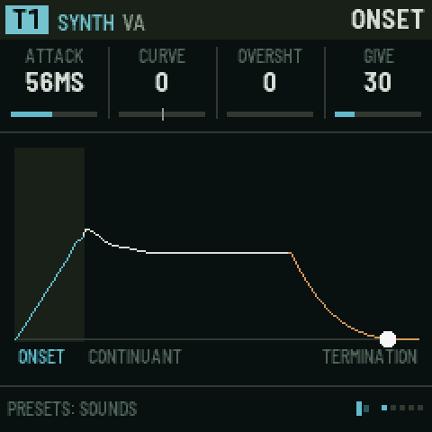</p>

Each track has two envelopes. The **volume envelope** (ENVELOPE, ONSET, LOOP / TAIL, DESTINATIONS) shapes the level and can move two more parameters. The **FILTER ENV** (three pages after it) opens and closes the filter.

The volume envelope is in three stages, named after how speech is described: the **onset** (how a sound starts), the **continuant** (how it holds) and the **termination** (how it ends). The first page holds the four times and the level you reach for most, attack, decay, sustain and release; the pages after it shape them. The picture draws the shape as you turn the knobs.

| Page | KNOB 1 | KNOB 2 | KNOB 3 | KNOB 4 |
| --- | --- | --- | --- | --- |
| **ENVELOPE** | ATTACK time (0.5 ms to 8 s) | DECAY time | SUSTAIN level | RELEASE time |
| **ONSET** | CURVE: − is a fast swell, + a slow one | OVERSHT: the attack overshoots and settles (a "bite") | GIVE: a spring in the level. It lags and bounces instead of moving straight. | – |
| **LOOP / TAIL** | LOOP: repeats the attack and decay while held (a rhythmic flutter; higher is faster) | TAIL: a quiet tail after the release (room for reverbs to bloom) | – | – |

(VELO, velocity sensitivity, is on EDIT › SOUND.)
| **DESTINATIONS** | DEST 1: any parameter of this track | AMOUNT 1 (±) | DEST 2 | AMOUNT 2 (±) |

DESTINATIONS lets the envelope move up to two more parameters, such as FM's LEVEL2 or CZ's DCW +-, so the timbre changes with the note.

### FILTER ENV

<p align="center">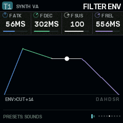</p>

The filter has its own envelope: delay, attack, hold, decay, sustain and release, with a bend on the attack and one on the falls, a loop and a speed. **ENV>CUT** sets how far it moves the cutoff, up or down (+40 on a new track). It is the same setting as on EDIT › FILTER, so turning either moves both. The envelope can also move one more thing of the track's, **F DEST**, by **F AMT**: with F LOOP on it is an LFO of the track's own, started by each note, where the two LFOS are shared by all tracks.

| Page | KNOB 1 | KNOB 2 | KNOB 3 | KNOB 4 |
| --- | --- | --- | --- | --- |
| **FILTER ENV** | F ATK: attack time (0.5 ms to 8 s) | F DEC: decay time | F SUS: sustain level | F REL: release time |
| **FENV SHAPE** | F DELAY: a wait before the attack | F HOLD: how long it stays at the top before the decay | A BEND: the attack's curve, + exponential (slow, then a rush), − logarithmic (a rush, then slow) | D BEND: the decay's and release's curve, + exponential (a fast fall, a long tail), − logarithmic |
| **FENV LOOP** | F LOOP: ON runs delay, attack, hold and decay round again while the key is held (with SUSTAIN at 0 it is a filter LFO that starts with the note) | F RATE: every stage faster (+) or slower (−), up to 16 times | – | – |
| **FENV ROUTE** | ENV>CUT: how far it moves the cutoff (±) | F DEST: a second destination, any of the track's modulation destinations (pitch, pan, drive, an engine's knobs, the volume envelope's times…) | F AMT: how far it moves F DEST (±; 0 off) | VCF KEY (also on PITCH) |

- **The picture** draws the whole envelope with its bends, marks the loop when it is on, and shows the playing note as a dot.
- **Which tracks:** synth tracks. With the LPG the filter follows the volume envelope instead, so these pages grey out there, unless F AMT sends the envelope somewhere: then it runs for F DEST. The CZ engine uses it like any other.
- **F DEST and F AMT:** the newest note's envelope, 0 to its peak, moves F DEST up by F AMT (or down, with F AMT below 0), as the volume envelope's DEST 1 and 2 do. The picture shows where it goes (INTO PAN +20, say). F DEST steps only through what can be moved.
- **Moving it:** F ATK, F DEC, F SUS, F REL, F RATE, ENV>CUT and F AMT are modulation destinations, so an LFO or the matrix can deepen the track's own one.
- **Older projects and sounds** load with a FILTER ENV copied from their volume envelope, so they sound as they did (the one envelope used to drive both). The factory presets do the same. The SHAPE envelopes of earlier versions are gone; a project that used one plays the classic volume envelope.

### STEP ENV and the LIBRARY

<p align="center">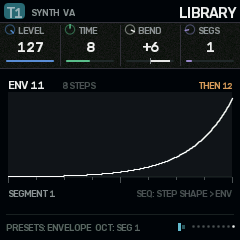</p>

The **LIBRARY** holds 32 **step envelopes**: shapes a step starts, that move one parameter across that step and on through the steps after it. A filter blip on one step, a fold that climbs over four, a pitch that drops on the last step of a bar. One number on a step calls up a whole motion, and envelopes can chain into each other for longer, more complicated moves.

**STEP ENV** says where they go, one destination per track:

| Page | KNOB 1 | KNOB 2 | KNOB 3 | KNOB 4 |
| --- | --- | --- | --- | --- |
| **STEP ENV** | SE DEST: the parameter it moves (any modulation destination of the track) | SE DEPTH: how far (±) | SE NOTE: OFF, or an envelope every note starts when its step names none | – |

- **Starting one:** set a step's **ENV** on SEQ › STEP SHAPE (or hold SEQ and ENV, hold the step's key and turn KNOB 1). When that step plays, its envelope starts from the beginning and replaces the one running.
- **Carrying on:** steps without an ENV leave the running envelope alone, so a long envelope or a chain moves through them. Set **SE NOTE** to have every such note start an envelope instead.
- **At the end** an envelope loops back to one of its segments, or hands over to its **NEXT** (a chain: the next one starts from where the last ended), or holds its last level. Stopping the sequencer puts the parameter back where its knob is.
- The picture on STEP ENV draws the envelope playing on the track, with a dot where it is.

**Editing an envelope (LIBRARY):** **PRESETS** picks the envelope (1–32). **OCT− / OCT+** step through its rows; the picture marks the segment on the knobs.

| Row | KNOB 1 | KNOB 2 | KNOB 3 | KNOB 4 |
| --- | --- | --- | --- | --- |
| **Segment 1–8** | LEVEL it goes to (0–127) | TIME it takes: in steps, to an eighth of a step (0 = a jump), or 0.5 ms to 8 s in FREE time | BEND: + exponential (slow, then a rush), − logarithmic (a rush, then slow) | SEGS: how many segments it has (1–8) |
| **The envelope's own** | START level | TIME: STEPS (synced to the track, the default) or FREE | LOOP: OFF, or back to segment 1–8 at the end | NEXT: NONE, or the envelope (1–32) that takes over |

Editing a segment past the last one adds it. The twelve factory envelopes, all synced:

| # | Name | What it does |
| --- | --- | --- |
| 1 | RAMP UP | rises over four steps and stays |
| 2 | RAMP DOWN | falls over four steps |
| 3 | BLIP | up at once, down in half a step |
| 4 | SWELL | in and out over four steps |
| 5 | DOUBLE | two blips half a step apart |
| 6 | STAIRS | four stairs, a step each |
| 7 | TRIANGLE | a two-step cycle, looping |
| 8 | S CURVE | slow, quick, slow, over four steps |
| 9 | DROP | holds a step, then falls |
| 10 | WOBBLE | a quarter-step flutter, looping |
| 11 | BUILD | eight steps up, then chains to 12 |
| 12 | FALL | down in a step (BUILD's ending) |

13 to 32 start empty. Projects made before this version get the twelve factory envelopes, and their steps' old library numbers are cleared (the old library swapped a step's volume envelope; set SE DEST to LEVEL for something like it).

## 8. LFO: modulation and macros

| Page | KNOB 1 | KNOB 2 | KNOB 3 | KNOB 4 | PRESETS |
| --- | --- | --- | --- | --- | --- |
| **MATRIX** | SOURCE | TRACK (1–8, GLOBAL, or MATRIX: another row) | PARAM (with MATRIX: ROW 1–8, that row's AMOUNT) | AMOUNT (±) | slot 1–8 |
| **LFOS** | L1 RATE | L1 SHAPE: SINE, TRI, RAMP, SAW, SQUARE, S&H, DRIFT | L2 RATE | L2 SHAPE | – |
| **LFO SHAPE** (OCT- / OCT+: LFO 1 or LFO 2) | SYM: skews the wave either way (± 64) | PHASE: where the wave starts, 0–359° | MODE: LOOP, RETRIG, 1 SHOT | – | – |
| **DUST** | RATE: how often random spikes happen, on average | DECAY: how long each spike lasts | SCATTER: how they fall. 0 random, like rain; up, spread out more and more evenly (+63: clockwork); down, in clumps, bursts of quick grains with long gaps between (−64: the most) | STRIKE: OWN, or DUST: strike tracks on the DUST or RAIN exciter take their grains from this source instead of their own RATE and ORDER (see below) | – |
| **MACRO** | DEST: what this slot moves | START value (±) | END value (±) | CURVE: LINEAR, EXP, LOG, S | which macro and slot |
| **MACRO WINDOW** | FROM %: where on the macro's travel this slot starts moving | TO %: where it stops | MACRO 1 | MACRO 2 | which macro and slot |

- **SYM** moves the middle of the cycle from 5% to 95%, so each half of the wave speeds up or slows down: a sine leans, a triangle turns into a rising or falling ramp, a square becomes a narrow or wide pulse. The matrix can move it (target GLOBAL › L1 SYM or L2 SYM), so another LFO, dust or an envelope can reshape an LFO as it runs.
- **A row can move another row:** set TRACK to **MATRIX** and PARAM picks a row (ROW 1 AMT to ROW 8 AMT, any but its own). This row's source then moves that row's AMOUNT, by up to this row's AMOUNT either way, on top of what it is set to. For example, row 1 is LFO 1 into a cutoff at 0, and row 2 is MACRO 1 into ROW 1 AMT at +63: the macro fades the LFO's sweep in. Rows can chain (row 3 moving row 2 moving row 1). On the MATRIX picture a moved row's amount turns bone and its bar shows the amount as it is now.
- **PHASE** is where the cycle starts. In LOOP it offsets the wave; in RETRIG and 1 SHOT it is where a note restarts it.
- **MODE:** LOOP (the default) runs freely. RETRIG starts the cycle over on every note, on any track. 1 SHOT plays one cycle from each note, then rests at the cycle's end: an extra envelope.
- The LFOS and LFO SHAPE pages draw both waves as SYM and PHASE make them; on LFO SHAPE the one on the knobs is lit.

<p align="center">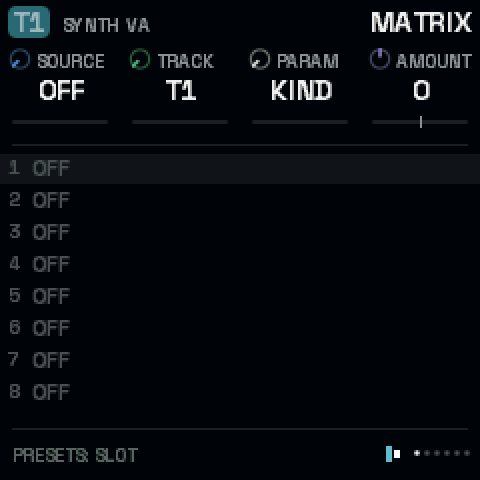 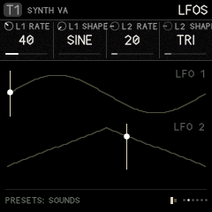 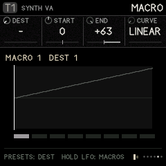</p>

**Matrix sources:**

- **LFO1, LFO2;**
- **DUST:** random impulses, like crackle, shaped by SCATTER;
- **ENV and VELO:** the *target* track's own envelope and velocity;
- **MACRO1–4;**
- **CLOCK:** a pulse on every clock tick;
- **KEY:** the note the *target* track is playing, centred on C4. At AMOUNT **+63** the parameter follows the keyboard exactly, one semitone per key (see below);
- **WHEEL:** MIDI CC 1 (the mod wheel) from MIDI in;
- **TOUCH:** aftertouch from MIDI in: channel pressure, or a keyboard's poly pressure (the latest key's). How hard you keep pressing a held key, for vibrato, a filter opening up, a swell;
- **BEND:** the pitch bend wheel from MIDI in, −1 to +1, centred at rest. Its AMOUNT is the bend's range in semitones: BEND › the track's PITCH at **+2** bends a whole tone each way, **+12** an octave (on CUTOFF it follows the keyboard's scale the same way; on other knobs, a step of the knob per unit). The matrix row names its track, so to bend several tracks, give each its own row.

The FM-1's own keys are switches: they play every note at the same velocity and have no pressure. VELO and TOUCH come alive with a MIDI keyboard that sends them (GLO › MIDI IN). For movement under your fingers on the FM-1 itself, map MACRO1–4 to the knobs you want and ride them, or record the knob moves.

**Dust that plays.** On LFO › DUST, turn STRIKE to DUST and every strike track on the DUST or RAIN exciter is struck by the DUST source's own grains, at its RATE and SCATTER, rather than by its own RATE and ORDER (which grey out). The same grains spike the matrix's DUST source and step a track clocked by DUST, so a body ringing, a filter jumping and a track stepping all happen together. A held note gets one grain as it starts, then only the source's. DUST's RATE tops out at about 50 grains a second; for denser rain, leave STRIKE at OWN.

**The matrix:** 8 slots, each "this source moves that parameter by this much".

1. Turn PRESETS to pick a slot.
2. Turn KNOB 1 to pick the source.
3. Turn KNOB 2 to pick the track.
4. Turn KNOB 3 to pick the parameter (only parameters that can move smoothly are offered).
5. Turn KNOB 4 to set the amount.

**Key tracking with KEY.** At AMOUNT +63, KEY moves these parameters by exactly one semitone a key: the **INSERT TUNE** of a COMB insert, **CUTOFF**, **PITCH** and **FINE**. Any other parameter moves one step a key. Smaller amounts track part of the way, and negative amounts turn the keyboard upside down. KEY reads the target track's newest note, so with several voices the comb follows the last key played.

*Example: a strike track whose comb rings in tune with the keys.*

1. On T5's **INSERT** page (EDIT), set INSERT to **COMB**. Leave TUNE at **C4**, its default. AMOUNT sets how strongly the comb rings (try 90–127), and MIX how much of it you hear (try 127).
2. Press **LFO** for the **MATRIX** page (not HOME › INFLUENCE: influence routes move a parameter by another track's envelope, not by the keys). Set SOURCE **KEY**, TRACK **T5**, PARAM **TUNE**, AMOUNT **+63**.
3. Play: the comb now rings in unison with every key. Turn TUNE to C5 for an octave above, or G4 for a fifth.

The comb reaches down to about F3; notes below that stop there.

**Macros:** 4 macros, each moving up to 8 destinations at once. Each destination has its own start and end values, curve, and window (FROM % / TO %).

- The window lets one knob turn do several things in sequence. For example, macro 1 from 0 to 50 % opens a filter, and from 50 to 100 % adds feedback.
- PRESETS walks through 32 slots: macro 1's eight destinations, then macro 2's, and so on.
- **To play the macros**, hold **LFO** and turn KNOB 1–4: they are macros 1–4 on any page.

## 9. FX: the buses

Each track can send part of its sound into three shared effects (buses): the delay, the space and the feedback loop. Their outputs go back into the mix.

**How the sends work.**

- On every FX page, one knob is called **`T1 SEND`** (or T2, T3…): that is how much of the *current track* goes into this bus.
- Turn **ALGORITHM** to set another track's send without leaving the page.
- The other knobs on the page set the bus itself, which is shared by every track.
- The same sends are also on EDIT › MIX and EDIT › SENDS.
- **Every effect starts off.** A new project's sends are all 0 and MASTER DRIVE is 0. Picking a sound with PRESETS leaves the track's sends where you had them, so no effect starts running because of a preset. The demos are the exception: they come with their own sends. A bus with nothing sent into it stops running once its tail has died away, so it costs nothing.

| Page | KNOB 1 | KNOB 2 | KNOB 3 | KNOB 4 |
| --- | --- | --- | --- | --- |
| **DELAY** | T SEND | TIME: free below the middle (10 ms to 0.5 s), tempo-synced divisions above | FEEDBK | LEVEL |
| **DELAY 2** | TONE: darker or brighter repeats | SPREAD: stereo ping-pong width (and how widely grains scatter) | DOUBLE: double tracking, a second wavering copy close behind | FREEZE: ON holds the repeats forever |
| **TAPE WEAR** | WOW: a slow, drifting sway of the tape's speed | FLUTTER: a fast waver | SATURAT: the tape driven, warm then gritty | AGE: darker repeats, hiss, dropouts |
| **GRAINS** | GRAINS: how much of the delay is a grain cloud (0: none) | DENSITY: how often grains start | SIZE: each grain, 20 ms to 0.4 s | PITCH: ±24 semitones |
| **SPACE** | T SEND | DECAY: how long it rings | DAMP: darker tail | LEVEL |
| **SPACE 2** | MOTION: a little chorus in the tail | CRUNCH: the stored samples from 12 bits down to 8 | LOW CUT: keeps the tail out of the bass | – |
| **BED** | LEVEL (0: off) | DENSITY: how often its dust falls | TONE: wood (left) to metal (right) | SHIMMER: the body an octave and two up, slowly beating |
| **BED 2** | DUCK: how far busy tracks hold it down | DECAY: how long the body rings | SPACE: how much of it goes into the space reverb | – |
| **FEEDBACK** | T SEND | TIME of the loop | REGEN: how much goes round again | LEVEL |
| **FEEDBACK 2** | PROCESS inside the loop: FILTER, COMB, SMEAR, SHIFT, FOLD, CRUSH | AMOUNT of the process | TUNE of the process | CUTOFF of the loop's filter |
| **FEEDBACK 3** | EDGE: a guard that keeps the loop from running away | RETURN: to the MASTER, or into a track (T1–T8) | BASE: a high pass in the loop, over the lower half of the range (20 Hz, off, to about 600 Hz) | WIDTH: a low pass over the upper half (20 kHz, off, down to about 650 Hz); with BASE, a band that narrows as they meet |
| **MASTER** | DRIVE: master saturation (0, off, by default) | CUT SIZE: length of a microcut | REPEATS: how many times a microcut repeats | CUT MIX |
| **MASTER 2** | C SHAPE: the punch-ins' cuts EVEN, BOUNCE or DRAG (as on SEQ › STEP CUT) | – | – | – |

<p align="center">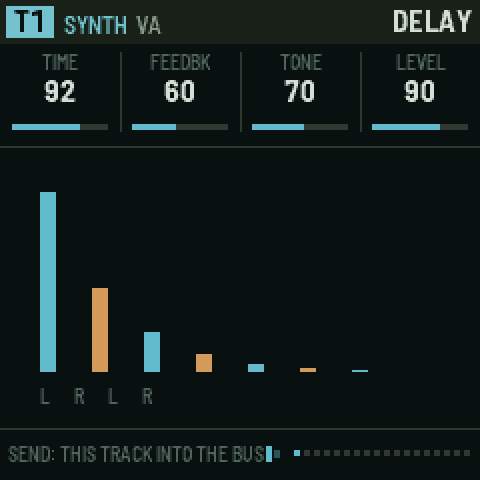 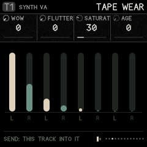</p>

**The delay is a tape.** One short loop of tape, written at half rate and 12 bits (about half a second), driven on the way in (**SATURAT**). The echoes read it at TIME while the tape's speed sways (**WOW**, slow and drifting) and wavers (**FLUTTER**, fast and shallow); each pass goes through TONE, the tape's **AGE** (darker, a little hiss, and now and then a dropout, more as it ages) and the saturation again, so the repeats wear down like an old tape echo's. **DOUBLE** adds two copies of what comes in, 18 and 27 ms behind and wavering apart: double tracking, one knob. **GRAINS** mixes in a cloud of up to eight grains read from the same tape around the echo (after Mutable Instruments' Beads, kept lofi): DENSITY, SIZE and PITCH shape them, WOW scatters them, SPREAD widens them, and the cloud feeds back into the tape with the echoes. **FREEZE** stops the tape recording, so the echoes and the cloud play what it holds: freeze a phrase, then turn GRAINS, SIZE and PITCH.

**The buses follow the matrix and the macros.** On LFO › MATRIX, TRACK = GLOBAL, the PARAM knob walks the settings that can be moved: the clock, the LFOs and dust, and each bus's main settings (delay time, feedback, tone, level, wow, grains; space decay, damp, level, motion; the feedback bus and its BASE and WIDTH; the BED; master drive and cut mix). The macros reach the same ones.

<p align="center">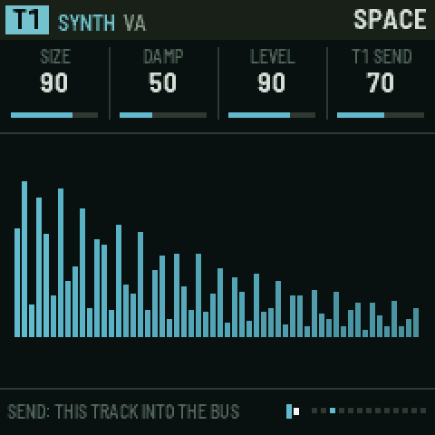 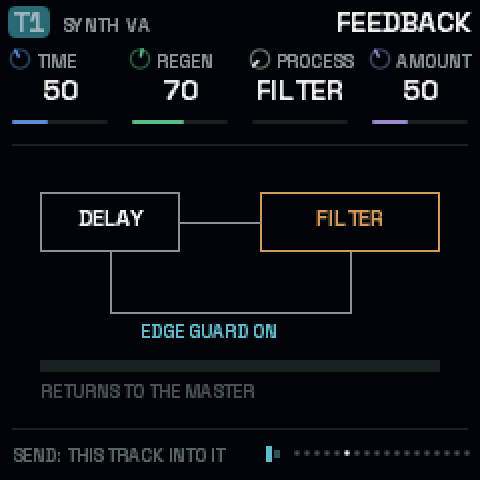</p>

**The space is 12-BIT**, a bright, metallic plate in the manner of late-1980s rack reverbs such as the Alesis Quadraverb: combs and allpasses run at half rate and kept in 12 bits, with the output held step by step, so the tail lisps, grains and aliases as it fades. **DECAY** is how long it rings and **CRUNCH** takes the stored samples from 12 bits down to 8. DAMP darkens it and MOTION adds a little chorus in the combs. (The FM-1 build keeps this one space; ROOM and CLOUDS, the filter pair, BANDS and the vocoder are in [Ravel Software](https://de-pattern.github.io/Ravel_FM1/software/), the full version for the browser.)

**The feedback bus** is a delay loop with an effect inside. Each pass goes through the effect again, so a comb rises into a ringing pitch, a shift climbs or falls, and a fold grows harsher.

- Send it into a track (**RETURN** T1–T8) and the loop feeds back through that track's own filter and skin.
- If it gets too loud, turn down REGEN or turn EDGE on.
- **BASE** and **WIDTH** (FEEDBACK 3) are a band filter inside the loop, no resonance: BASE raises a high pass from the bottom, WIDTH lowers a low pass from the top, and turned all the way they nearly meet near 600 Hz, so each pass keeps only a narrow band. At BASE 0 and WIDTH full the loop is open.

<p align="center">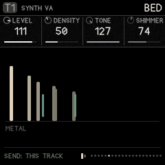</p>

**The BED** is a quiet layer under everything: grains of dust, and a breath of soft noise, falling on a small body tuned to the scale's root (SCL › ROOT). At TONE's left the body is wood, its modes spread like a marimba bar's and short; at the right it is metal, its modes clustered and inharmonic, and it rings long. SHIMMER adds its two lowest modes an octave and two octaves up, beating slowly. **DUCK** lets the tracks hold it down, quickly when they play and slowly letting go, so the bed comes up in the gaps between hits. **SPACE** sends it into the space reverb: with a long DECAY it becomes a grainy floor under the clicks. The picture shows the body's modes, the shimmer, the dust as it falls and, with DUCK up, how far it is held down. The dust is random, as dust is; the bed plays no notes and changes nothing in the patterns.

**Microcuts** (MASTER page) are slivers of the master output, looped, reversed or stuttered. Trigger them from steps (SEQ › STEP SHAPE › CUT, with their own shape and size on STEP CUT) or with the FX punch-ins (their shape: MASTER 2 › C SHAPE).

**Punch-in effects:** hold **FX** and press white keys **1–8**:

| Key | 1 | 2 | 3 | 4 | 5 | 6 | 7 | 8 |
| --- | --- | --- | --- | --- | --- | --- | --- | --- |
| Effect | LOOP (microcut) | REVERSE | STUTTER | FREEZE the delay | LOW PASS sweep | HIGH PASS sweep | THROW: everything into delay and space | FILL: steps set to FILL play |

The effects last while the key is held. Letting go of FX releases them all.

## 10. SCL: scale

<p align="center">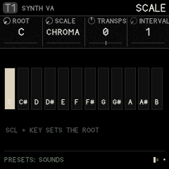</p>

| KNOB 1 | KNOB 2 | KNOB 3 | KNOB 4 |
| --- | --- | --- | --- |
| ROOT: C to B | SCALE: CHROMA (off), MAJOR, MINOR, DORIAN, PHRYG, LYDIAN, MIXO, PENTA, MINPENT, WHOLE, HIRAJO, IWATO | TRANSPS: transposes everything that plays from steps (±24) | INTERVAL: this track plays only notes this many semitones apart from the root (1–12) |

- **The keys fold into the scale** (like Elektron's fold mode). With a scale set, every key plays: the lowest key plays the first scale note at or above F, and each key after it plays the next note of the scale, so the keyboard runs up through the scale across several octaves and no key is wrong or dead. With CHROMA the keys are chromatic again. Notes you record from the keys are recorded as played.
- **The sequencer snaps** each step's note to the nearest scale note (a note exactly between two goes down).
- **INTERVAL** (per track): a track with interval N only plays notes that are a multiple of N semitones from the root; other notes are skipped. INTERVAL 1 plays everything, 12 only the roots, 7 the root and the notes a fifth apart (stacked fifths: the fifth, the ninth…), 2 every other semitone. Give two tracks the same notes with different intervals and they split them between them.
- **Set the root from the keys:** hold **SCL** and press a key.

## 11. ARP: the arpeggiator

<p align="center">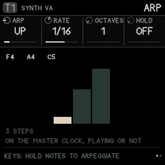</p>

**ARP** opens the arpeggiator of the current track. Each track has its own, off until you turn **ARP** (KNOB 1) away from OFF. Then every note the track gets (the keys you hold, its own steps, an influence's TRIG) is held instead of played, and the arpeggiator plays the held notes one at a time on the master clock, whether the transport runs or not. Let go of the keys and it stops.

| Page | KNOB 1 | KNOB 2 | KNOB 3 | KNOB 4 |
| --- | --- | --- | --- | --- |
| **ARP** | ARP: OFF, UP, DOWN, UP-DN, DN-UP (both turn at the ends without playing the end twice), PLAYED (the order the keys came), RANDOM | RATE: 1/4 (a beat), 1/8, 1/8T (triplets), 1/16 (a step), 1/16T, 1/32 | OCTAVES: 1–4, the notes again an octave up each round | HOLD: the notes stay after the keys let go, until you play a new chord (see below) |
| **ARP 2** | GATE: 5–100 % of its step (100: each note runs into the next, legato, so a mono synth with GLIDE slides) | REPEAT: each note 1–4 times | CHANCE: 0–100 % that a step plays (else a rest) | – |

**HOLD** works with the arpeggiator off too. Then it is a sustain for the keys: the notes you play keep sounding after you let go, until the first key of your next chord (which then sounds on in their place), or until you turn HOLD off. It holds what you play on the keys, not the track's steps.

The picture shows the notes it holds, in the order they came, and one round of the pattern they make: a column a step, as high as its note, the step it just played lit.

- **With the sequencer:** a step's chord (X2 to X4) or overlapping notes arpeggiate for as long as they last; when the transport starts, the arpeggiator lines up with the bar.
- **Recording:** with REC armed, what you play is recorded as you play it (the chord, not the arpeggio), so the arpeggio comes back the same on playback.
- A **kit** has no arpeggiator (its keys are lanes); a single PERC drum does.

## 12. SEQ: steps and the graph

Every track has its own sequencer, with **two patterns (A and B)** of up to **64 steps**.

- **PRESETS** switches pattern while on SEQ pages, and so do black keys **1** and **2**.
- **Black key 9 (COPY)** picks the current pattern as the source. **Black key 10 (PASTE)** copies that pattern, as it is at that moment and with a kit's locks, into the current one: switch to the other pattern, or to another track, first. A kit's pattern pastes only into a kit, and a note pattern only into a note track. Pasting over steps asks first: press it twice. The pattern's steps are copied; the track's LENGTH and RATE stay the target's own.
- **Black key 11** clears the pattern: press it twice (the first press asks).
- A pattern launched while playing waits for the current one to finish (its LENGTH, at its RATE), then starts from its first step, so patterns of any length change cleanly. (A GRAPH track has no end, so it changes on the next bar.) Scenes change on the next bar.

### The step keys

While you are on any SEQ page, or while you **hold SEQ** on any other page, the **16 white keys are steps**.

| Action | Result |
| --- | --- |
| Tap a key | The step toggles on/off |
| Hold a key, turn a knob | Edits that step's value (on STEPS, STEP TIMING, STEP SHAPE, GRAPH) |
| Hold a key, turn a knob on a **non-SEQ page** (with SEQ held) | A **parameter lock**: that step plays with that value (cutoff, drive, a source value…). Up to two locks per step. |
| **OCT− / OCT+** | Step page 1–16, 17–32, 33–48, 49–64 |

Editing a held empty step switches it on.

<p align="center">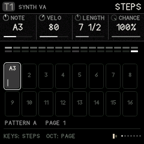 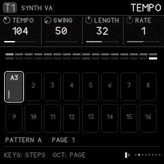 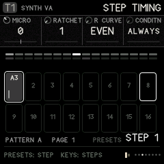 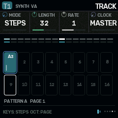</p>

| Page | KNOB 1 | KNOB 2 | KNOB 3 | KNOB 4 |
| --- | --- | --- | --- | --- |
| **STEPS** | NOTE | VELO | LENGTH: how long the note holds, in eighths of a step to 16 steps ("7 1/2"), then in half steps up to 64 steps | CHANCE: 0–100 % that it plays |
| **TEMPO** (right after STEPS; on a kit, after DRUM) | TEMPO (30–240): the master clock's, the same value as GLO › CLOCK, so turning either moves both | SWING (shared with GLO › CLOCK too) | LENGTH: the track's (as on TRACK) | RATE: the track's (as on TRACK) |
| **STEP TIMING** | MICRO: nudge −6 to +12 (in 24ths of a step) | RATCHET: 1–8 repeats within the step | R CURVE: EVEN, FASTER, SLOWER, BOUNCE (see below); "-F" versions fade out | CONDITN, see below |
| **STEP SHAPE** | ENV: the LIBRARY envelope this step starts (– = none; see ENV › STEP ENV) | CUT: NONE, LOOP, REVERSE, STUTTER (a master microcut on this step) | TIE: ON holds the note until the track's next note starts | R MOVE: what each repeat of a ratchet does (see below) |
| **STEP CUT** | CUT (as on STEP SHAPE) | C SHAPE: EVEN, BOUNCE, DRAG | C SIZE: MASTER (the MASTER page's CUT SIZE), or 1/32 to 1/2 of a step | – |
| **TRACK** | MODE: **STEPS** or **GRAPH** | LENGTH: 1–64 | RATE: ¼× to 4× the master clock | CLOCK: MASTER, LFO1, LFO2, DUST |
| **DIRECTION** (steps mode) | FWD, REV, PINGPONG, SNAKE (rows of four, walked back and forth) | – | – | – |
| **EUCLID** (the last SEQ page) | HITS | ROTATE | LENGTH (the track's) | – |

<p align="center">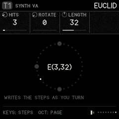</p>

**EUCLID** spreads HITS as evenly as they go over the track's LENGTH (5 over 16 is x..x..x..x..x...., the first on step 1) and ROTATE turns the pattern round. It writes ordinary steps as you turn: the steps it lights are steps like any others, with their notes, locks and ratchets, and you can edit them by hand from there. HITS starts from how many steps play now. Each turn rewrites which steps play (up to LENGTH), so turn it to find a rhythm, then leave it. On a kit the page is LANE, HITS, ROTATE and the lane's LENGTH, and it writes the chosen lane only: give each lane its own length and hits for rhythms that interlock and drift. The picture is the pattern as a ring, E(hits, length) in the middle.

**Ratchets that move.** A ratchet repeats the step's note within the step. Two settings change how the repeats fall and sound:

- **R CURVE BOUNCE** spaces the repeats like a ball dropped on a table: the gaps shrink and each repeat is softer than the last. (EVEN, FASTER and SLOWER place them evenly, closing up or opening out; their "-F" versions fade.)
- **R MOVE** changes each repeat: **UP** and **DOWN** climb or fall a step of the scale per repeat (on a kit lane, two semitones); **DARK** closes each repeat down, darker, quieter and shorter than the one before, so a metal hit turns to wood as it rolls.

Together they give the bouncing, tumbling bursts of IDM: a hat on RATCHET 6, BOUNCE, DARK falls like a coin; a snare on 4, FASTER, UP rises into the next bar. On a kit, R CURVE and R MOVE are on STEP TIMING (KNOB 2 and KNOB 4) and act on the lanes that roll on that step.

**Cuts with a shape.** A step's CUT is a microcut of the whole mix (see FX › MASTER). On STEP CUT:

- **C SHAPE EVEN** repeats the sliver as it is; **BOUNCE** makes each repeat shorter and a little higher, like a ball settling (it adds a few repeats to settle in); **DRAG** plays each slower and lower, a tape winding down.
- **C SIZE** sets the sliver against the step, from 1/32 to 1/2 of a step (at most 93 ms), so it follows the tempo; MASTER uses CUT SIZE.

While a cut plays its sliver is held, so every repeat is of the same moment.

**Conditions** (CONDITN) decide on which passes through the pattern a step plays:

- **ALWAYS**;
- **FIRST** (only the first time) and **NOT 1ST**;
- **1:2, 2:2** (first or second of every two passes);
- **1:3 … 3:3**;
- **1:4 … 4:4**;
- **FILL** (only while the FILL punch-in is held) and **NO FILL**.

**CLOCK** lets a track step by something other than the master clock:

- **LFO1/LFO2** step on each LFO cycle;
- **DUST** steps at random;
- an influence **CLOCK** route steps on another track's notes.

All of these give rhythms that drift against the grid.

On the STEPS picture:

- the top strip is the whole pattern, with the playing step bright;
- the grid is the current page of 16;
- each box shows the note and a velocity bar;
- outlined boxes are where the playheads are.

### GRAPH mode (Silt's sequencer)

<p align="center">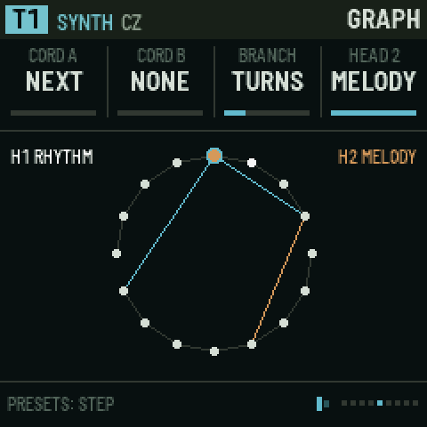 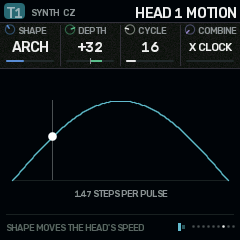</p>

Set **SEQ › TRACK › MODE** to **GRAPH**. Now the steps sit in a circle, and each step has **cords** that say where a playhead goes next, instead of always moving to the following step. The pages after TRACK change to GRAPH, HEAD 1, HEAD 1 MOTION (and HEAD 2, HEAD 2 MOTION when head 2 is on).

**GRAPH drives the same steps.** It is not a second sequencer: the steps you set on the STEPS pages (which are on, their notes, velocity, length, locks, ratchets and the rest) are exactly what plays in GRAPH mode too. GRAPH only changes **the order the playhead visits them**, and adds a second playhead. Edit the steps on STEPS, STEP TIMING and STEP SHAPE in either mode; draw the cords on GRAPH.

| Page | KNOB 1 | KNOB 2 | KNOB 3 | KNOB 4 | PRESETS |
| --- | --- | --- | --- | --- | --- |
| **GRAPH** | CORD A: the step to go to next, 1 to LENGTH (NEXT = just the following step) | CORD B: a second choice (NONE = no branch) | BRANCH: how to choose between A and B | HEAD 2: OFF, NOTES, RHYTHM, MELODY | step to edit |
| **HEAD 1** | TRANSP: head 1's transpose | – | – | – | – |
| **HEAD 1 MOTION** | SHAPE | DEPTH (±) | CYCLE: 2–64 steps | COMBINE: × CLOCK or + CLOCK | – |
| **HEAD 2** | PLAYS: THIS track, or T1–T8 | H2 RATE | H2 START: the step it starts on (1 to LENGTH) | TRANSP | step |
| **HEAD 2 MOTION** | SHAPE | DEPTH | CYCLE | COMBINE | – |

**Making a graph:**

1. Go to the GRAPH page.
2. Pick a step with **PRESETS**, or hold its white key. With more than 16 steps (TRACK › LENGTH), the white keys hold 16 at a time: **OCT+** and **OCT−** move them to steps 17–32, 33–48 and 49–64 (and put that page's first step on the knobs). The steps on the keys turn slate on the circle, the step on the knobs keeps its colour with a slate edge, the footer says which steps the keys hold (KEYS: 17-32), and the step on the knobs is named (STEP 17).
3. Set **CORD A** (where it goes) and, if you want a branch, **CORD B**. The cords are drawn on the circle. A cord can only point at a step that exists (1 to the track's LENGTH). If you shorten LENGTH later, cords to steps past the end are ignored: they read NEXT or NONE until LENGTH grows again.
4. Choose **BRANCH**, which decides between A and B at a fork:
   - **CHANCE:** a coin toss;
   - **TURNS:** alternate each visit;
   - **LFO1/LFO2:** by the LFO's sign;
   - **MOTION:** by the head's function generator (above half way takes B).

**Two playheads** walk the same graph at once.

- **Head 1** plays this track.
- **Head 2** is off until you choose what it does with **HEAD 2** on the GRAPH page. It has its own rate and start step, and can play **another track** (HEAD 2 › PLAYS).

**HEAD 2** chooses how the two heads share the work. Head 1 always takes the other half, so no setting leaves the track silent:

| HEAD 2 | Head 2 | Head 1 |
| --- | --- | --- |
| **OFF** | – | plays the steps it visits |
| **NOTES** | plays the steps it visits too: two voices on one graph | plays the steps it visits |
| **MELODY** | picks the notes, plays nothing itself | plays the rhythm, with head 2's latest note |
| **RHYTHM** | plays the rhythm, with head 1's latest note | picks the notes, plays nothing itself |

With **MELODY** or **RHYTHM**, rhythm and melody walk two different paths at two different speeds, so they never quite line up the same way twice. The picture shows each head's job at the top (H1 and H2).

**MOTION** (Silt's function generators) moves a head's *speed* as it travels.

- **SHAPE:**
  - RISE, FALL, ARCH, DECAY or SWELL, traced once every CYCLE steps;
  - or LFO 1, LFO 2 or DUST, followed live.
- **DEPTH** sets how far it pushes; negative reverses the effect.
- **COMBINE** sets how it meets the clock:
  - **× CLOCK** multiplies or divides the clock (up to two octaves faster or slower), so it accelerates and decelerates musically;
  - **+ CLOCK** adds to the clock's rate (from slowing to a near halt up to racing).
- The MOTION picture draws the shape, where the head is on it, and its current speed in steps per pulse.

## 13. GLO: song, scenes and clock

<p align="center">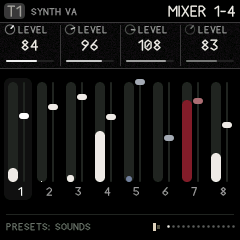 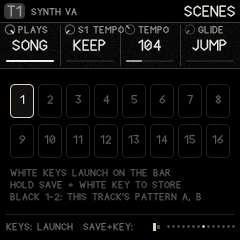 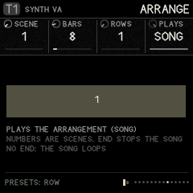</p>

| Page | KNOB 1 | KNOB 2 | KNOB 3 | KNOB 4 | PRESETS |
| --- | --- | --- | --- | --- | --- |
| **MIXER 1-4** | T1 LEVEL | T2 LEVEL | T3 LEVEL | T4 LEVEL | – |
| **MIXER 5-8** | T5 LEVEL | T6 LEVEL | T7 LEVEL | T8 LEVEL | – |
| **CLOCK** | TEMPO (30–240) | SWING: 50 % is straight, 66 % a triplet shuffle, up to 100 % (every second 16th pushed late) | B DOES: how oscillator B bends the clock | DEPTH of that bending | – |
| **CLOCK B** | A SHAPE: the main clock's wave | B RATE | B SHAPE | THRESH: where a pulse fires | – |
| **CLOCK FEEL** | TEMPO IS: LOCKED (keeps the average tempo) or FREE (drifts) | QUANTZE: pulls microtiming back to the grid (0–100 %) | METRO: the metronome, OFF, QUIET or LOUD (a click on each beat, higher on the bar's first) | COUNT-IN: OFF, 1 BAR (the default) or 2 BARS | – |
| **MIDI IN** | MIDI CH: OMNI (any channel plays the current track), 1–16 (only that one), or MULTI (channels 1–8 play T1–T8, for a sequencer driving every track) | CLOCK IN: RAVEL (its own clock) or MIDI (24 clocks a beat from USB or the TRS jack; the picture shows the tempo measured, or that none is coming) | START/STP: FOLLOW (MIDI Start and Continue start the transport, Stop stops it) or IGNORE | – | – |
| **MIDI LEARN** | LEARN: turn it right to arm, then turn any knob on any page, then move a control on your controller | DELETE: turn twice to delete the one PRESETS picked | CLEAR ALL: turn twice | – | which learned control |
| **SCENES** | PLAYS: PATTERN (you launch) or SONG (the arrangement runs) | S1 TEMPO … S16 TEMPO: the tempo the current scene sets when it launches, or KEEP (turn fully left) to leave the tempo alone | TEMPO: the tempo now | GLIDE: JUMP, or 1–8 bars (see below) | scene |
| **ARRANGE** | SCENE for this row, or END (past 16): the song stops when it gets there | BARS it lasts (1–64) | ROWS: how many rows the song has | PLAYS (as above) | row |
| **ARCS** | DENSITY of this point (0–100 %) for the current track | SPAN: each point lasts 1, 2 or 4 bars (16, 32 or 64 bars in all) | – | – | point 1–16 |
| **CPU** | CORES: 2 (the default) gives the FM-1's second core the effects and every other voice; 1 turns it off (see below) | FLASH WT: OFF, or ON to count how much of the render waits for its code to come from the flash | – | – | – |
| **STRESS** | STEP: OFF, or 1–16, each adding load to the last (below) | ENGINE: the synth engine the voices use | AUTO: RUN walks the steps, three seconds each, and fills in the table | – | – |
| **FLASH** | – (read only: how the boot set the flash up) | | | | – |
| **PANEL** | BACKLIGHT: OFF, LOW (the default), MID, HIGH: how brightly the unlit buttons and keys glow, on the FM-1 | – | – | – | – |

<p align="center">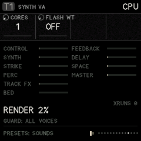 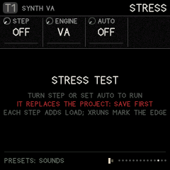</p>
<p align="center"><sub>(Taken on the desktop simulator, a far faster machine: the same project reads many times higher on the FM-1.)</sub></p>

**CPU: where the audio's time goes.** The bars show how much of the time the audio has each part of the render takes: CONTROL (the sequencer, modulation, the knobs), SYNTH, STRIKE, PERC, TRACK FX, BED, FEEDBACK, DELAY, SPACE and MASTER. A bar's full length is 50 %. RENDER is the total on the first core (the one that must keep up); past about 90 % the FM-1 falls behind. PEAK is the busiest single audio block lately (all of it, the screen's share included): when it nears 100 %, that block was nearly late. CORE 2 is the second core's share: the effects and the voices it plays (a part's bar counts its time on whichever core runs it); WAIT is how much of the first core's time went on waiting for it. **XRUNS** counts the blocks that came too late: each one is a crackle, and a steady stream of them is the loud noise an overloaded FM-1 makes. Measured on the FM-1 and the desktop simulator; the browser has no clock for it.

**The overload guard.** When the render takes more than 80 % of the time it has, the guard fades out a voice over about 3 ms: a released one first, then a note of the track with the most voices sounding (a chord loses a note before a lone line goes quiet), then the oldest; more than one at once when the load is far over. Its reading rises at once and falls slowly, so a chord landing on the last one's release is met in the block it comes. It then holds the voice count there (a new note past the limit makes room the same way) until the load has stayed under 76 % for a moment, and lets it back up a voice at a time. The CPU page shows it (GUARD: 6 VOICES, and how many it has faded). It only acts when the voices are what costs; if the effects alone are too much, turn some sends down. It never acts in the browser.

**Two cores.** The FM-1's chip has two cores, and Ravel starts the second at power-on. It runs the effect buses (the BED, FEEDBACK, DELAY and SPACE), and it takes every other sounding voice, synth, strike or drum, while the first core plays the rest and every track's chain. It takes only as many voices as keep it from holding the first core up: when the effects are heavy it takes fewer, and the CPU page shows its share (CORE 2 40 %). For this the buses play one control step behind the tracks: the effects come about 3 ms after the dry sound, with one core or two, so the sound is the same either way. On some units the second core misreads memory, so it is watched: if it ever reads a wrong job or doesn't finish one in time, the first core takes the work back at once (CORE 2 FAILED on the CPU page), and after any restart with it running (a crash, a hang, an update) it stays off until the FM-1 is switched off and on. CORES 1 turns it off by hand.

<p align="center">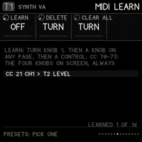 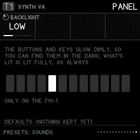</p>

**MIDI control of the knobs.** Two ways, and both follow MIDI IN's channel:

- **CC 70–73: the knobs on screen.** On any page, CC 70 turns KNOB 1, 71 KNOB 2, 72 KNOB 3 and 73 KNOB 4, whatever they are on that page (a sound's knobs on EDIT, a step's while one is held, the mixer on GLO). Any controller with four knobs set to send 70–73 plays the whole instrument, page by page.
- **MIDI LEARN: one control, one parameter.** On GLO › MIDI LEARN, turn **KNOB 1 (LEARN)** right; the footer says LEARN: TURN A KNOB. Go to any page and turn the knob you want (a track's or a global one, such as T3's CUTOFF or the delay's FEEDBACK); the footer says LEARN: MOVE A CONTROL. Move the control on your controller: it's tied ("CC 21 CH1 > T3 CUTOFF") and moves that parameter from then on, wherever you are. Up to 16; the page lists them. **PRESETS** picks one, **KNOB 2 (DELETE)** turned twice deletes it, **KNOB 3 (CLEAR ALL)** turned twice clears them all. Learning a control that's tied already moves it to the new parameter; a learned control wins over 70–73.
- **Pickup.** A control only takes hold once it reaches the value the parameter already has (or passes it), so changing page, project or sound never makes a value jump. Turn it through the value shown and it follows.
- The learned controls, like MIDI IN's settings and the backlight, belong to the FM-1, not to a project: they stay through power-off and whatever you load.

**PANEL.** The FM-1's buttons and keys glow dimly, so you can find them in the dark; what's lit (the page's button, a step, a key held) stays lit fully, so the two never get mixed up. BACKLIGHT sets how dim: OFF, LOW, MID or HIGH. The glow comes from the panel's own scanning (each unlit LED is lit on one scan in a few), so it costs the sound nothing and the keys are read as before. It's kept through power-off.

**FLASH.** The page after STRESS shows how the FM-1's boot set its flash up: the chip, its status (QE: whether its four-wire mode is allowed), the flash controller's read mode and clock divider. It is read once at start and nothing on it writes the flash. A photo of it tells whether a faster read is possible on that unit.

**FLASH WAIT.** The FM-1 runs Ravel's code straight from its flash memory, through a cache. When the code the render needs is not in the cache, the core waits for the flash. FLASH WT ON counts those waits and shows them as a share of the render (FLASH WAIT 30 %). The busiest audio code already runs from the chip's RAM (the delay, the space, the feedback loop, the BED, every synth voice's filter and amplifier, the VA oscillator, the master's limiter, the modulation step, the voices' envelopes and their hand-off between the cores, and, in the RAM the tape left free, every synth engine, the strike voices and the 33 drum machines); a high number says more of it should. The counters are not verified on hardware yet, so it is off by default.

**STRESS: how much this FM-1 takes.** The stress test replaces the project in memory (save yours first; it asks twice), builds a project that adds load a step at a time, and plays it, with the overload guard off so you see the real edge:

| Step | Adds | Step | Adds |
| --- | --- | --- | --- |
| 1 | nothing (the idle cost) | 9 | every track into the DELAY |
| 2 | 1 voice of ENGINE, held | 10 | the delay's GRAINS, busy |
| 3 | 2 voices | 11 | TAPE WEAR: wow, flutter, age |
| 4 | 4 voices | 12 | every track into the SPACE |
| 5 | 8 voices | 13 | the FEEDBACK bus |
| 6 | 2 strike voices, hit on every other step | 14 | the feedback's PROCESS (a frequency shift) and its band |
| 7 | a drum kit, a hit on every step | 15 | the BED, with SHIMMER and a send to the space |
| 8 | a second drum kit, a hit on every step | 16 | MASTER DRIVE |

Each step is measured from its first second to its third; the table shows the RENDER % for each step (and the second core's after a /, when it works), red with a ! where XRUNS started. Each effect step's rise over the one before is what that effect costs. AUTO RUN walks all sixteen in under a minute and leaves the table on screen: a photo of it says exactly what this FM-1 can do. Change ENGINE to compare engines (STEP 5 is 8 voices of it). Turn STEP to OFF to stop. Loading any project or demo ends the test.

<p align="center">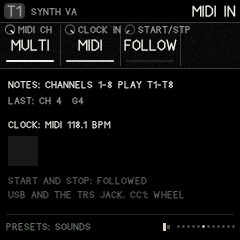</p>

**MIDI in.** Notes from a keyboard or a sequencer, over USB or the TRS jack, play a track as its keys do, and are recorded when it is armed (with their timing, as the keys are). Velocity comes through as played. CC 1 is the matrix's WHEEL, aftertouch (channel or poly pressure) its TOUCH and pitch bend its BEND; CC 120 and 123 stop every note. With CLOCK IN at MIDI, Ravel follows the incoming clock (every 6th of its 24 a beat is a step) and its own TEMPO waits; Start starts from the top. Steps are counted from the clocks themselves, so Ravel never drifts from the sender, however long it runs. On the FM-1 each clock is timed as it comes in, and its step lands one audio block (2.9 ms) later at the same spacing, so the steps keep the sender's timing rather than snapping to the blocks. MIDI notes step-record too (below). **Controllers:** CC 70, 71, 72 and 73 always move KNOB 1–4 of the page on screen, as if you turned them, with nothing to set up; and GLO › MIDI LEARN ties any control to one parameter, wherever you are (below). The MIDI IN settings belong to the FM-1, not to a project: they stay as you set them through power-off and whatever project you load (on the FM-1 they are written to the flash a second after a change, or as soon as you leave the page, playing or not, which can leave a moment's gap in the sound once; the page's last line says KEPT THROUGH POWER-OFF when they are). In the emulator, **Listen to MIDI** (left panel) takes every MIDI input on the computer.

**Metronome and count-in.** METRO clicks while the sequencer plays; the click goes straight to the output and is never recorded. With REC armed, PLAY first counts in (the clicks sound even with METRO off, and the screen shows COUNT-IN with the beats left), then starts at step 1. Notes played during the count-in are not recorded, except one played just before step 1, which lands on it. Without REC, PLAY starts at once.

**Scenes** are snapshots of every track's pattern (A/B), levels, influence routes, mutes and macros.

- **Store:** hold **SAVE** and press a white key (1–16). Over a stored scene, the first press asks: press again to overwrite.
- **Launch:** on the SCENES page, press a white key. It changes on the next bar. Black keys 1–2 there switch the current track's pattern.
- **Glide:** with **GLIDE** set to 1–8 bars, a launched scene (or an arrangement row) changes its patterns and mutes on the bar as before, but the track levels, the macros and the influence routes' amounts travel to the scene's over that many bars, easing in and out. A route the new scene adds grows from nothing; a route it drops fades, then goes. GLIDE JUMP switches everything at once, as before. Stopping mid-glide lands on the scene.

**Arrangement:** a list of up to 32 rows, each "play scene S for B bars".

1. Set **ROWS** to the number of rows the song needs.
2. Pick each row with **PRESETS** and set its SCENE and BARS.
3. Set **PLAYS** to SONG and press PLAY.

Without an END row the song loops back to row 1. Give the last row the scene END to have the transport stop there. A scene with its own tempo (S TEMPO) changes the tempo when its row starts.

**Density arcs.** For each track, draw 16 points of density, each lasting SPAN bars (1, 2 or 4: an arc of 16, 32 or 64 bars, so a part can stay quiet for a long stretch and open up once).

- At 100 % every step plays. Lower values thin the part out, off-beats first and downbeats last.
- One pattern can then breathe across a phrase without writing new patterns.
- Pick the bar with PRESETS and the track with ALGORITHM.

**The clock** (after Silt's two-oscillator clock).

- Oscillator A is the tempo. **B DOES** lets a second, slower oscillator bend it:

  | B DOES | Effect |
  | --- | --- |
  | STEADY | No bending |
  | RATE | Speeds up and slows down |
  | SHAPE | Changes the swing-like shape |
  | PHASE | Pushes and pulls the pulses |
  | SUM | Adds the waves |
  | AND, OR, XOR | Logic rhythms between the two |

- With **DEPTH** at 0 the clock is straight.
- **TEMPO IS: FREE** lets it drift like an old drum machine.
- **Tap tempo:** hold **GLO** and tap black key **1**.
- **Mute and solo:** hold **GLO** and press white keys **1–8** to mute tracks 1–8, or **9–16** to solo tracks 1–8.

## 14. SAVE: projects and sounds

SAVE has two pages: **PROJECT** (the whole song) and **SOUNDS** (one track's sound at a time). Turn **SELECT** to go from one to the other.

### Projects

<p align="center">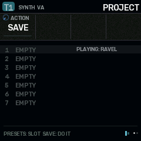</p>

1. Press **SAVE** to open the page.
2. Turn **PRESETS** to choose a slot (1–32). The picture shows eight at a time around the chosen one, which are used and their names, and on the FM-1 how much room the projects have left (**ROOM**).
3. Turn **KNOB 1 (ACTION)**:

   | Action | What it does |
   | --- | --- |
   | SAVE | Saves the project to the slot |
   | LOAD | Loads the slot |
   | DEMO 1 | The Ravel demo |
   | DEMO 2 | Dust |
   | DEMO 3 | The graph demo |
   | INIT | A new, blank project |
   | CLEAR | Empties the slot, so it shows EMPTY and its room is free again (the project you have open stays as it is) |

4. To name the project, use **KNOB 2 (CURSOR)** to pick a letter's place (1–11) and **KNOB 3 (LETTER)** to choose it (A–Z, 0–9, space and - + # & ' .), as on SOUNDS. The name shows on the right, with a mark under the letter on the cursor. It belongs to the project you are working on, so name it before you SAVE; LOAD brings back the name it was saved with.
5. Press **SAVE** once: the footer says "PRESS SAVE AGAIN TO CONFIRM".
6. Press **SAVE** again to do it.

Ravel starts on a blank project every time it is switched on (or the emulator is opened). Saved projects stay in their slots: load one with **LOAD**.

There are 32 project slots. On the FM-1 a project is kept compressed (most fit in one 4 KB block of the flash, a very busy one in a few), so they share the room: **ROOM** on the page says how much is left, and if a save doesn't fit, it says **NO ROOM: SAVE OVER ANOTHER** and nothing is lost. Projects saved in slots 1–7 by an earlier version are still there; the first save after updating compresses them too, which takes a second or two once.

A project holds everything: all eight tracks and their patterns, influence, modulation, buses, scenes, the arrangement, arcs and the LIBRARY of step envelopes. A project saved before the tape was removed still loads: its tape tracks come back as blank VA synths with empty patterns, and influence TAPE routes are switched off.

### Sounds: your own bank

<p align="center">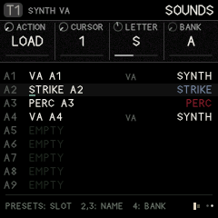</p>

Four banks (**A–D**) of 32 slots for your own sounds, 128 in all, of any kind: a synth on any engine, a strike, a perc machine or a whole kit. Each has a name, and its kind is shown on the right of the list (**SYNTH**, **STRIKE**, **PERC**, **KIT**; a synth also shows its engine). The banks are shared by every project and stay when you load another project or switch off.

A sound is the track's voice: its kind and engine, every sound setting (source, filter, skin, envelopes, insert, sends, the CZ patch, a kit's lanes). It is not the track's steps, sequencer settings or pan.

1. Press **SAVE**, then turn **SELECT** to **SOUNDS**.
2. Turn **KNOB 4 (BANK)** to a bank, then **PRESETS** to a slot. Slots are named by bank and number (A1 … D32), and PRESETS runs on from one bank into the next (A32, then B1).
3. Turn **KNOB 1 (ACTION)**:

   | Action | What pressing **SAVE** does |
   | --- | --- |
   | LOAD | Puts the sound on the current track. A sound of another kind turns the track into that kind (a PERC sound on a synth track makes it a perc track). |
   | SAVE | Keeps the current track's sound in the slot. An empty slot saves at once, named after the factory preset it came from (or its engine and slot, like VA B3). Over a used slot, press **SAVE** twice; the slot keeps its name. |
   | CLEAR | Empties the slot (press **SAVE** twice) |

4. **Name it:** on a used slot, **KNOB 2 (CURSOR)** picks a letter position (1–11) and **KNOB 3 (LETTER)** changes the letter (A–Z, 0–9, space and `- + # & ' .`). The cursor is the amber line under the name. The name is kept a moment after you stop turning.

Loading a sound that changes a track between a kit and notes (lanes and notes don't read each other's steps) clears that track's steps, so it asks first: press **SAVE** again.

**From PRESETS:** on any EDIT page, turning **PRESETS** walks the factory sounds of the track's kind and then your own of that kind, from the bank chosen here (knob 4): the footer and the top bar name each one (A3 MY BASS). So a sound you keep is a turn of PRESETS away on any track.

**In the emulator**, your sounds are at the top of the sound menu under **My sounds**, one group per bank, each with its slot (A1 … D32) before the name and its kind in brackets after it. Choosing one loads it into the current track, switching its kind if needed. **Save sound…** keeps the current track's sound (it asks for a slot such as B5, offering the first empty one, and a name), and **Delete sound…** removes one. The panel's SAVE › SOUNDS page works too.

### Moving projects and sounds to an FM-1 (and back)

Everything you have saved, the projects in slots 1–32 and the sound banks A–D, can leave the emulator as a file and go onto an FM-1 running Ravel, and the other way. The FM-1's own update leaves its saved projects and banks alone, so install the firmware first, then bring your work over.

**In the emulator** (the *Projects & sounds* panel on the left):

| Button | What it does |
| --- | --- |
| **Export file** | Every saved project and sound bank, as one `.ravel` file to keep |
| **Import file** | A `.ravel` file into the emulator's slots (it asks before replacing used ones) |
| **Send to FM-1** | This page's saved projects and banks straight onto an FM-1 connected by USB with Ravel running (Chrome or Edge: allow MIDI when asked; it asks before replacing slots on the FM-1) |
| **Get from FM-1** | The FM-1's saved projects and banks, read into a `.ravel` file (Import file then brings them into the emulator) |

**From the command line** (`pip3 install mido python-rtmidi`), with the FM-1 connected and Ravel running:

    python3 tools/fm1_data.py info                      # what the FM-1 holds
    python3 tools/fm1_data.py restore my-work.ravel     # the file's projects and banks onto the FM-1
    python3 tools/fm1_data.py backup fm1-work.ravel     # the FM-1's, into a file
    python3 tools/fm1_data.py restore my-work.ravel --only project3,bankB

Each project and bank goes to the same slot it came from (project 3 to project 3, bank B to bank B) and replaces what was there; slots not in the file are left as they are. Every piece is checked as it arrives (a CRC over the whole slot), and a slot only becomes valid on the FM-1 once all of it has arrived intact; the screen says RECEIVED PROJECT 3 or RECEIVED BANK B as each one lands. Load a project afterwards with SAVE › PROJECT › LOAD.

## 15. Hold layers

Hold a button (in the emulator: right-click or shift-click to latch it) and the keys or knobs do something else. The footer always shows the layer's hint.

| Hold | Then | Does |
| --- | --- | --- |
| **SEQ** | white keys | Steps, from any page. Hold a step and turn a knob to lock that value on that step. |
| **SEQ + ENV** | hold a step, turn KNOB 1 | The step's LIBRARY envelope |
| **LFO** | KNOB 1–4 | Macros 1–4 |
| **FX** | white keys 1–8 | Punch-ins: loop, reverse, stutter, freeze, low pass, high pass, throw, fill |
| **GLO** | white keys 1–8 / 9–16, black 1 | Mute / solo, tap tempo |
| **SAVE** | white key | Store scene 1–16 |
| **SCL** | any key | Set the root |

<p align="center">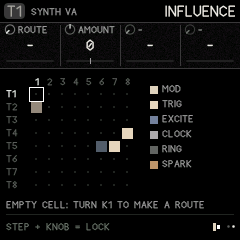 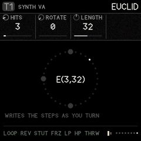</p>

## 16. Recording

1. Choose the track with **ALGORITHM**.
2. **Tap REC.** "RECORDING ARMED" flashes and a red dot appears in the footer.
3. Press **PLAY**.
4. Now, while it plays:
   - **notes you play** are written into the steps, with their timing kept as microtiming; **chords** too: keys pressed together land on one step as a chord of up to four notes (the step's note and up to three more), and play back together. A note played on a step while none of its keys is still down replaces what was there;
   - **knobs you turn** are written as parameter locks on the playing step;
5. **Tap REC** again to stop recording.

Turning ALGORITHM while armed moves recording to the new track.

**Step recording.** With the transport stopped, open a SEQ page and tap **REC**: the keys play notes, and a red cursor sits on the step after the last note (STEP REC 5 on the screen; its key blinks).

<p align="center">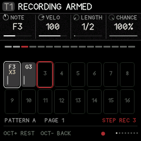</p>

- Play a note, or hold a chord (up to four keys together): it goes on the cursor's step, replacing what was there (the step's locks and tricks stay). When you let go of the last key, the cursor moves to the next step.
- **OCT+** leaves a rest (empties the step) and moves on. **OCT−** goes back a step, to play it again.
- **Hold SEQ and tap a step** to put the cursor there, for instance to change one chord in the middle of a pattern.
- **Hold REC and press OCT− or OCT+** to change the keys' octave.
- Notes from a MIDI keyboard step-record too.
- Press **PLAY** to hear it: recording carries on live as usual. Stop, and step recording picks up after the last note. Tap **REC** to finish.

Step recording is for synth and strike tracks; a kit's keys stay its steps (tap them in).

**Chords on steps.** A step with a chord shows **X2**, **X3** or **X4** (how many notes) under its note on the STEPS page. NOTE moves the whole chord, its shape kept; transposition, the scale and INTERVAL apply to each note. The chord's notes share the step's velocity, length, ratchets and timing. To make a step a single note again, record one note over it. Chords need the voices: a synth track plays up to four notes at once (VOICES on EDIT › SOUND).

**Recording from a SEQ page.** On the SEQ pages the keys are normally the steps. With REC armed on a synth or strike track they play notes instead, so you can watch the steps fill in as you play (the footer says REC: KEYS PLAY); OCT- and OCT+ change the octave rather than the step page (while it plays; stopped, they are step recording's rest and back). Hold **SEQ** for the keys to be steps again for a moment: tap one to add or remove a step, then let go and keep playing. Tap REC to stop, and the keys are steps again. A kit keeps its keys as steps on SEQ pages; play its lanes from any other page.

## 17. Recipes, step by step

**Make a first sound**

1. Turn **ALGORITHM** to T1.
2. Press **EDIT** (SOUND page). Turn **KNOB 2** to **CZ**.
3. Turn **PRESETS** to hear the CZ sounds (CZ BRASS, CZ BELL, CZ STRINGS…); play the keys.
4. Turn **SELECT** to **DCW 1**. Turn **PRESETS** to step 1 and turn **KNOB 2 (LEVEL)** up to make the attack brighter.
5. **SELECT** to **DCA 1**. On step 1, turn **KNOB 1 (RATE)** down for a slow swell.

**Write a beat**

1. Turn **ALGORITHM** to T5 (strike).
2. Press **SEQ**. Tap white keys **1, 5, 9, 13**. Press **PLAY**.
3. Hold key **13** and turn **KNOB 2 (VELO)** down for a softer hit.
4. **SELECT** to STEP TIMING. Hold key **9** and turn **KNOB 2 (RATCHET)** to 3 for a roll.
5. To lock a sound change on one step:
   1. Press **EDIT**, SELECT to SOURCE 1.
   2. Hold **SEQ**, hold key **5**, turn **KNOB 4 (TONE)**.
   3. Let go. Only step 5 is brighter.

**Two-headed graph melody**

1. ALGORITHM to T1. **SEQ**, switch some steps on with different NOTEs (hold a key, turn KNOB 1).
2. SELECT to TRACK, **MODE** = GRAPH.
3. GRAPH page: pick step 4 with PRESETS, set **CORD A** = 1 (it loops back), **CORD B** = 8 (or branches ahead), **BRANCH** = TURNS.
4. HEAD 1: **ROLE** = GATE, **HEAD 2** = PITCH.
5. HEAD 2: **H2 RATE** = 2/3, **H2 START** = 5.
6. HEAD 1 MOTION: **SHAPE** = ARCH, **DEPTH** = +32, **CYCLE** = 16. The rhythm speeds up and slows down over 16 steps while the melody walks its own path.

**Put reverb on just one track**

1. ALGORITHM to the track. Press **FX**, SELECT to SPACE.
2. **KNOB 4** (`T3 SEND`, for example) up. The other tracks' sends stay where they were.
3. SPACE 2: raise **MOTION** for a moving tail and **LOW CUT** to keep it out of the bass.

**One track plays another**

1. ALGORITHM to T5 (the source). Press **HOME**, SELECT to INFLUENCE.
2. **PRESETS** to column 2, T2 (the target). **KNOB 1** = TRIG, **KNOB 3 (DELAY)** = 2, **KNOB 4 (CHANCE)** = 60.
3. Now 60 % of T5's hits also play T2 two steps later.

**Save your work**

1. **SAVE**, **PRESETS** to a slot, **KNOB 1** = SAVE.
2. Press **SAVE**, then **SAVE** again.

**Keep a sound and use it on another track**

1. Pick the track with the sound. **SAVE**, **SELECT** to SOUNDS.
2. **PRESETS** to an empty slot, **KNOB 1** = SAVE, press **SAVE**.
3. Name it with **KNOB 2** (position) and **KNOB 3** (letter).
4. ALGORITHM to another track, **KNOB 1** = LOAD, press **SAVE**. The track becomes the sound's kind if it wasn't already.

## 18. Quick reference

| I want to… | Press / turn |
| --- | --- |
| Pick a track | ALGORITHM (emulator: 1–8) |
| Next page | SELECT, or tap the section button again (FX: the next bus) |
| Change a sound | PRESETS on any EDIT page |
| Start / stop | PLAY (emulator: Space) |
| Turn steps on | SEQ, tap white keys |
| Edit one step | Hold its key, turn knobs |
| Lock a value on a step | Hold SEQ + step, turn a knob on any page |
| Pattern A / B | Black key 1 / 2 on SEQ, or PRESETS |
| Mute / solo | Hold GLO + white 1–8 / 9–16 |
| Tap tempo | Hold GLO + black 1 |
| Change the tempo | SEQ › TEMPO (or GLO › CLOCK), KNOB 1 |
| Arpeggiate a chord | ARP, KNOB 1 to UP (or another mode), hold the keys |
| Glue the whole mix | T8: HOME › TRACKS, KIND = COMP; EDIT › COMP |
| Store a scene | Hold SAVE + white key (twice over a stored one) |
| Launch a scene | GLO › SCENES, white key |
| Play macros | Hold LFO, turn KNOB 1–4 |
| Punch-in effects | Hold FX + white 1–8 |
| Record | Tap REC, then PLAY (on SEQ pages the keys then play notes; hold SEQ for steps) |
| Name a project | SAVE › PROJECT, KNOB 2 cursor, KNOB 3 letter |
| Save | SAVE, choose slot and action, SAVE twice |
| Keep or load a sound | SAVE › SOUNDS (SELECT), KNOB 4 bank, PRESETS slot, KNOB 1 = SAVE or LOAD, SAVE |
| Move projects and sounds to an FM-1 | Emulator: Export file / Send to FM-1; or `tools/fm1_data.py restore FILE` |
| A per-track LFO | ENV › FENV LOOP: F LOOP on; FENV ROUTE: F DEST and F AMT |
| One row of the matrix moving another | LFO › MATRIX: TRACK = MATRIX, PARAM = ROW n |
| A kit lane faster or slower | SEQ › DRUM, KNOB 3 RATE (or the lane's LANE page) |
| Choose a kit lane's machine | EDIT › LANE n (black keys 3–8), PRESETS |
| Spread hits evenly (a track or a kit lane) | SEQ › EUCLID: HITS, ROTATE |
| A bouncing, darkening roll | SEQ › STEP TIMING: RATCHET, R CURVE BOUNCE; STEP SHAPE: R MOVE DARK |
| A stutter that settles or drags | SEQ › STEP CUT: C SHAPE, C SIZE (punch-ins: FX › MASTER 2) |
| Every hit a little different | EDIT › SKIN 2: GRAIN (strike, perc) |
| A dusty bed under everything | FX › BED: LEVEL, TONE; BED 2: DUCK, SPACE |
| One track's hits ringing a strike track | HOME › INFLUENCE: route SPARK |
| Scenes that glide | GLO › SCENES: GLIDE 1–8 bars |
| Record a chord onto a step | Tap REC, PLAY, press the keys together |
| Enter notes and chords step by step | Stopped, on SEQ: tap REC, play each note or chord (OCT+ a rest, OCT− back) |
| Graph steps past 16 | GRAPH page, OCT+ / OCT− |
| A long reverb | FX › SPACE: DECAY near the top |
| A worn tape echo | FX › DELAY, then TAPE WEAR: WOW, FLUTTER, SATURAT, AGE |
| Grains in the delay | FX › GRAINS: GRAINS up |
| A crunchier reverb | FX › SPACE 2: CRUNCH up (fewer bits) |

## 19. Questions people ask

**A page I saw before is gone.**

- It only shows when it applies. SOURCE 3 and 4 depend on the engine. The graph's HEAD pages appear only in GRAPH mode, HEAD 2's only when head 2 is on.
- Holding LFO does not change pages: it puts the macros on the knobs.

**The FX page changes a value for every track.**

- Only the knob named **T_ SEND** is per track. Everything else on a bus page is the shared effect.

**The graph doesn't seem to do anything.**

- Check SEQ › TRACK › MODE is GRAPH.
- Steps need to be on (tap them).
- With no cords, each step just goes to the next one, so it sounds like a normal sequence until you add cords or branches.

**The FM-1 crackles, or makes a loud noise.**

- The audio is taking longer than it has. Open GLO › CPU: if RENDER is near or over 90 % and XRUNS is counting, that's it. The bars show which part costs most.
- Fewer voices (EDIT › SOUND › VOICES), fewer tracks playing at once, or lower effect sends bring it down. The overload guard fades out voices on its own, but it can't help when the effects alone are too much.
- To know this unit's limits, run GLO › STRESS with AUTO.

**Something got loud or stuck.**

- Press **Panic / stop all** (emulator), or stop and start.
- High FEEDBACK REGEN and delay FEEDBK can build up; the master limiter stops it reaching your speakers.

---

## Installing on the FM-1

**Installing any custom firmware is at your own risk.** The installer never touches the FM-1's boot area, and M-VAVE's own firmware can always go back on (below).

1. Open Ravel's site (the repository's GitHub Pages: the emulator) in Chrome or Edge on a computer, and press **Install on FM-1** at the top.
2. Connect the FM-1, switched on, directly to the computer with a USB data cable.
3. Press **Install**, allow MIDI when the browser asks, and wait until it says it is done. Don't unplug part way. The FM-1 restarts into Ravel.

The installer page shows the latest release at the top and installs it unless you choose otherwise: its **Version to install** list also has the ten most recent releases (an older one warns that projects saved with a newer version may not open in it, so export them first) and, when `main` has moved on since the last release, the newest **test build** (`dev-` and the commit, with its date). The Install button names the version it writes. The FM-1 shows the version it runs on its start screen and on GLO › FLASH.

From the command line instead (`pip3 install mido python-rtmidi`): `python3 tools/fm1_install.py Ravel-FM1.fwsc`. The `.fwsc` is on the site (`firmware/Ravel-FM1.fwsc`) and on the repository's releases.

The installer works from M-VAVE's own firmware, from Ravel, and from the other community firmwares. **To go back**, the same page writes M-VAVE's own FM-1 firmware (which you download from M-VAVE) back over the same cable; M-VAVE's own updater, M-UPGRADE, works too.

### If the FM-1 will not start

- **Hold OCT− and OCT+ for 5 seconds** while Ravel runs: the FM-1 goes into its update mode, and the installer can write any firmware.
- **Safe mode:** if Ravel crashes twice while starting, it starts in a safe mode instead: no sound, USB on, so the web installer can reach it. PLAY tries Ravel again.
- **Calibration:** hold OCT− and OCT+ while switching on to teach Ravel which button and knob is which, if the panel seems mixed up.
- **Last resort:** if nothing shows on the screen but the FM-1 appears on USB in the chip's update mode, `tools/fm1_rescue.sh` (from X0X) puts M-VAVE's firmware back from a Mac. Beyond that, recovery needs the [FM-1-transporter](https://github.com/kurogedelic/FM-1-transporter).

## What's here

| Path | What |
| --- | --- |
| `firmware/app/` | Ravel: the engine (`rv_engine.c`), synth engines (`rv_synth.c`), strike (`rv_strike.c`), buses (`rv_bus.c`), sequencer (`rv_seq.c`), modulation and clock (`rv_mod.c`), parameters, presets, projects, and the interface (`rv_ui.c`, `rv_gfx.c`). Portable C99, single-precision float, no C library. |
| `firmware/fm1/` | The FM-1 side, bare metal: Felucca's hardware layer (`hal/`), start-up and memory map, the update loader (`loader/`), and in `src/`: USB, LCD, storage, the update entry, the panel map, Ravel's platform (`plat_fm1.c`) and the boot, audio interrupt and main loop (`main_fm1.c`) |
| `host/` | The simulator: the whole app on a desktop, driven by scripts, writing screenshots and WAV files |
| `web/emu/` | The browser emulator: the same code compiled to WebAssembly, on a drawn FM-1 panel |
| `tests/scenarios/` | Simulator scripts that play the firmware and check it (`tour.rvl` visits every page; `manual.rvl` takes the manual's screenshots) |
| `docs/` | The signal-flow diagram, and `docs/manual/`: the panel drawing and the screenshots used in this manual |
| `tools/` | The FM-1 build (`build_fm1.py`, `fm1pkg_make.py`), the installer and rescue tools, the site assembler (`make_site.py`), toolchain and SDK-file downloads, font and table generators |
| `web/installer/` | The web installer (Web MIDI), from Felucca and X0X |
| `tests/fm1/` | Felucca's update-path tests, run against Ravel's package; `projstore_test.c`, the compressed project store on a simulated flash (power cut at every write) |

## Building

The simulator (any Unix with a C compiler, and Python with Pillow):

```
sh host/build_host.sh
./build/host/ravel_host tests/scenarios/tour.rvl build/out    # screenshots and audio in build/out
```

The browser emulator (clang with the wasm32 target and wasm-ld; no emscripten):

```
sh web/emu/build.sh          # web/emu/ravel.wasm
node web/emu/test.mjs        # smoke test
python3 web/emu/bundle.py    # build/web/ravel-emulator.html, one file to open in a browser
```

The FM-1 firmware, on Linux x86-64 (JieLi's clang for the AC791N; on a Mac, X0X's build runs it in Docker):

```
sh tools/get_toolchain.sh ~/.jieli                     # JieLi's Linux toolchain
sh tools/get_ac79_files.sh ~/ac79                      # three files of JieLi's AC79 SDK the package contains
JIELI_TOOLCHAIN=~/.jieli/toolchain AC79_SDK=~/ac79 python3 tools/build_fm1.py [--release 0.3]
```

`build_fm1.py` builds Felucca's update loader and the app (the platform at `-Os`, the instrument at `-O2`), checks the image (entry point, no calls from RAM code into flash, no ROM references, no double-precision code, register access only in `hal/`, the RAM and pool budgets) and packages `build/fm1/Ravel-FM1.fwsc`. A release build's identity is `FM-1_82` and the version as two digits each (`0.4.1` is `FM-1_82000401`); a build without a version is `FM-1_82`. 82 ("R") is Ravel's own: no other firmware uses an identity starting with it. (0.4.0 and earlier were `FM-1_96…`.)

The site (what the Pages workflow publishes): `python3 tools/make_site.py _site build/web/ravel-emulator.html build/fm1/Ravel-FM1.fwsc VERSION`.

Publishing: every push to `main` rebuilds the site (enable it once under Settings → Pages → Source: GitHub Actions); pushing a tag such as `v0.3` also makes a release with the firmware and the emulator.

## The FM-1 build

Ravel runs bare metal on the FM-1's JieLi AC791N, on the open hardware layer that Felucca wrote and X0X carried on: no vendor SDK, no RTOS. A 10 kHz timer scans the keys, encoders and LEDs and runs USB; the codec's DMA interrupt asks Ravel for 512 frames at a time (two calls of 256), and the main loop draws the interface about 30 times a second.

- **Flash:** the app is about 200 KB of the 568 KB app slot.
- **RAM:** the platform uses about 45 KB of the 96 KB main RAM; the instrument's state (voices, buses; the 120 KB the tape used is free) about 280 KB of the 336 KB pool.
- **Storage:** eight project slots of 32 KB in the flash's data area; the panel calibration beside them.
- **USB:** MIDI, and USB audio *to* the computer (Ravel's output, recordable). MIDI in on the TRS jack too: notes, CC 1, clock, start and stop (GLO › MIDI IN).
- **Not checked on hardware:** everything. In particular the CPU load of a dense project (the render runs inside the DMA's deadline; an overrun drops a block; the CPU meter in the top bar shows it, and the TINE and PHYS engines cost the most), and moving projects and sounds over USB (tools/fm1_data.py and the emulator's Send to FM-1).
- **Not in this version:** Bluetooth, audio input.

## Ravel Software

The FM-1 has to fit everything into a small chip, so this firmware keeps only what runs well on it. The fuller version, with every engine and effect it had before (ROOM and CLOUDS spaces, the filter pair, BANDS and the vocoder), lives on as **Ravel Software**, for the browser: [play it here](https://de-pattern.github.io/Ravel_FM1/software/) ([its manual](https://de-pattern.github.io/Ravel_FM1/software/manual.html)). The emulator's **Software** button opens it. It is kept on the `software` branch and doesn't run on the FM-1.

## Licence

GPL-3.0 only (see `LICENSE`). The FM-1 platform layer, loader, installer and tools are Felucca's and X0X's (GPL-3.0). A firmware package also contains three files of JieLi's AC79 SDK (Apache-2.0). The CZ engine is a port of MAME's uPD933 emulation (BSD-3-Clause). Third-party code is listed in `THIRD_PARTY.md`.

## Credits

- Mutable Instruments (Émilie Gillet) for Beads, whose grains the delay's GRAINS follows (Ravel Software also follows Clouds' reverb in its CLOUDS mode).
- [Felucca](https://github.com/hugelton/Felucca) by Leo Kuroshita (@kurogedelic), Hügelton Instruments: the FM-1's open hardware layer, USB, storage, update loader and web installer that Ravel runs on.
- [X0X](https://github.com/charlesvestal/fm1-x0x), a Felucca fork, for the platform as Ravel takes it, the simulator's design, its PNG writer and the build, install and rescue tools.
- The authors of JIANT, SLOOP and sloopDX, and everyone who mapped the FM-1.
- XAOC Devices' Zadar, whose library of morphing shapes the WAVE engine's WAVE ENV follows (the shapes are Ravel's own).
- The screen is set in Ravel's own runic stroke alphabet (`tools/runic_glyphs.py`: straight strokes only, curves turned into points), drawn at eight times the size and brought down to the screen at 16 levels. The palette is black and greys with bone and verdigris accents; tracks are told apart by colour: synth white, strike slate, tape verdigris, perc maroon.
- Moog's MF-105 MuRF, whose fixed resonant bands and patterns Ravel Software's BANDS bus follows.
- E-mu Systems, whose Z-plane filters the Z filters follow in spirit (the frames are Ravel's own designs).
- Maxime Denuc's Nachthorn and Dorian Concept's SH-101 playing, which the ORGAN and MONO engines are made to sound like (Ravel's own synthesis; no recordings used).
- Elektron's Machinedrum, whose synthesis machines and their documented parameters the PERC tracks are built from (Ravel's own designs; no Elektron code or data).
- Kurzweil's VAST and E-mu's patch-cord functions, whose idea of building sound from function blocks the LOGIC engine follows.
- Wolfgang Palm's PPG Wave and Waldorf's Microwave, whose wavetables, stepping and wave envelope the WAVE engine follows, and Xfer's Serum, whose phase warps it borrows the idea of (the tables are Ravel's own).
- Devin Acker and MAME, whose uPD933 emulation shows how the Casio CZ's sound chip works (the CZ engine follows it; BSD-3-Clause, see `THIRD_PARTY.md`).

<p align="center">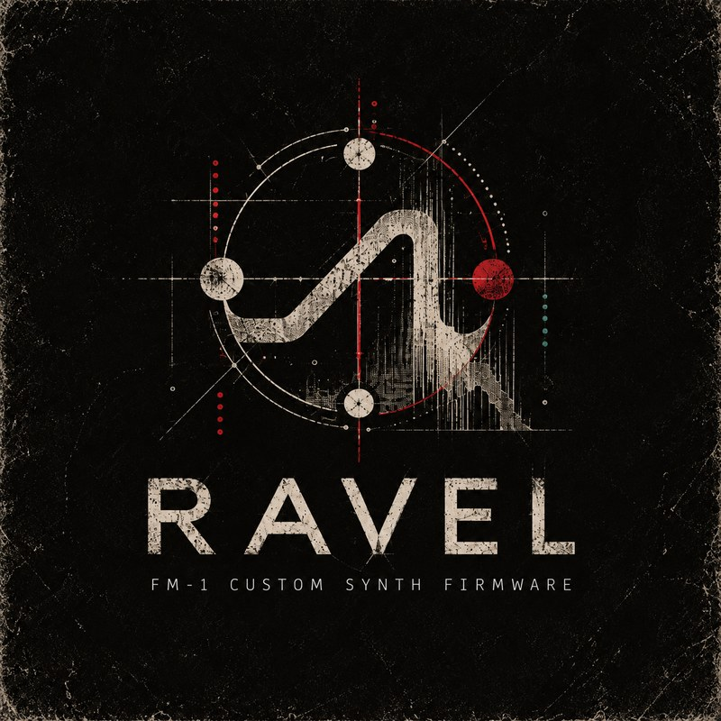</p>
