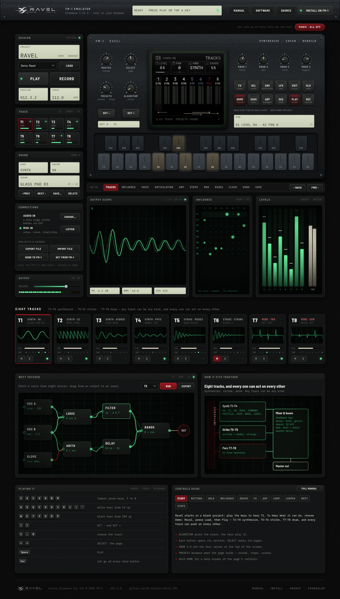

# Emulator page redesign

A new look for the browser emulator page, as an editable design file.



**Direction:** a dark medical monitor in a black, finely speckled matte-plastic case. Phosphor-green traces for
anything live, sunken pale readouts for values, cream for held keys, maroon only for selection, recording
and warnings. The FM-1's screen sits in a CRT bezel and shows the firmware's real render, untouched.

## What changed from the current page

- **Header** becomes a metal nameplate: wordmark, firmware version, one status readout, and the links
  (Manual, Software, Source, Install on FM-1). Panic moves out on its own as a maroon button.
- **Left rack** is grouped into modules — Session (project, load, play/record, position, tempo), Track,
  Sound, Connections (audio in, MIDI in, file and USB transfer) and Output.
- **GO TO** leaves the side panel and becomes a page rail under the device.
- **New monitor strip** makes what's happening visible: output scope, the influence matrix
  (from → to, dot size = amount) and per-track and master meters.
- **Eight tracks** become channel strips, each with a live trace, level, influence dots, mute/solo.
- **WEFT patcher** and **How it fits together** are redrawn as phosphor schematics; the guides keep their
  content in tidier columns.

## Files

| File | What it is |
| --- | --- |
| `ravel-emulator-redesign.fig` | The design: *Emulator — Desktop 1440* and *Components & tokens* |
| `desktop-1440.png`, `components.png` | Previews |
| `src/` | The design as Figma Plugin API code (`lib.js` helpers, `desktop.js`, `components.js`) |
| `build.py`, `textures.py`, `assets/` | Rebuild the .fig and the metal, grain and CRT textures |

## Opening it

- **OpenPencil:** open `ravel-emulator-redesign.fig` in the app or at app.openpencil.dev.
- **Figma:** drag the .fig into the file browser (or *Import*). It was written by OpenPencil, so check
  shadows and image fills after import.

## Rebuilding

Needs Node and Python (numpy, Pillow).

```sh
npm i -g @open-pencil/cli
python3 textures.py          # regenerate assets/ textures (optional)
python3 build.py             # writes out/ravel-emulator-redesign.fig and PNG previews
```

The scripts in `src/` are plain Plugin API code, so they can also be pasted into a Figma plugin to draw the
same frames there.
